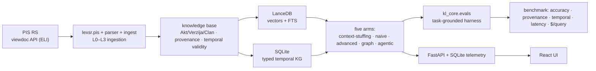

# Architecture — srb-legal-rag

> System shape: the package boundary, the seams, and a map into the design docs. **The full design lives in the six self-contained docs under [`docs/design/`](./design/)** — this file is the index into them, and describes the system as it is now.

## System shape

## The two-package boundary

- **`kl_core`** is **domain-free** — the seams + types (`Provenance`, `Chunk`, `Query` with `as_of`, `RetrievalResult`, `Answer`, the `RetrievalBackend`/`LLMClient`/`Embedder`/`SchemaPolicy` protocols, the `evals` harness). Nothing legal-specific may enter it: it is extracted as its own package when a second domain skin lands.
- **`lexsr`** is the **Serbian-legal skin** — `pis`, `parser`, `registry`, `ingest`, `annex`, `index`, `kg`, `metadata`, `translit`, the five `arms`, `evals`, `bench`, `diagnose`, `runstore`, `config`, `api`.

## The seams (contracts)

| Seam | Contract |
|---|---|
| `kl_core.types` | `Provenance` (incl. `version`) · `Chunk` · `Query(as_of)` · `RetrievalResult` · `Answer` (citations mandatory unless `abstained`) |
| `kl_core.ingest.Ingestor` | corpus → `Iterable[Chunk]`; never a chunk without provenance |
| `kl_core.retrieval.RetrievalBackend` | `retrieve(Query) -> RetrievalResult`; latency/cost instrumentation mandatory. The five arms in `lexsr.arms` form a **strict-superset ladder** — `naive → advanced → advanced+graph → agentic` — where advanced+graph reuses advanced's `base._smart_retrieve` backbone as its seeds, so each delta isolates exactly one capability. `RetrievalArm.answer()` adds multi-turn condensation. Arms take an `AblationConfig` (per-capability toggles, default = full pipeline); the exact config rides each run's telemetry |
| `kl_core.llm.LLMClient` | `generate(...) -> GenerationResult` — token counts + cost mandatory; JSON-schema output via native structured outputs on both providers. Production call sites go through **`generate_json`/`generate_text`** (≤3 attempts on parse/shape failures; truncation retried once at a 2× escalated cap, ceiling 32768; cross-attempt `GenAccounting`); providers retry HTTP statuses **and transport blips**; per-stage attempts/failures ride run extras as `llm_io` |
| `kl_core.embeddings.Embedder` | `embed(texts, task_type) -> EmbeddingBatch`, cost accounted |
| `kl_core.kg.SchemaPolicy` | `decide(observation, schema) -> SchemaDecision` (COERCE/EXTEND/DEFER, logged) — the schema-evolution seam |
| `kl_core.evals` | `TaskItem` (free-form `capability` label — lookup / cross_reference / temporal / delegated_norm / cc_validity / abstain) → `ItemScore`; `score_item(retrieved_keys=…)` + `aggregate`. Metrics: correctness (cross-family LLM judge, date-aware on dated items) + deterministic citation P/R/F1 keyed **period-aware** (`citation_keys`, `@version`-pinned golds match one slice, unpinned match any), **retrieval recall** & the retrieval−citation gap, temporal correctness, **misgrounded/hallucination** and **`temporally_wrong_and_cited`** as independent axes over a fixed answerable denominator, abstention quality — all literature-anchored in [benchmark.md §4](./design/benchmark.md) |

## Stack choices

Embedded stores, boring dependencies, no service to run. The choices that would otherwise look arbitrary:

- **LanceDB for vectors + FTS**, version-pinned. The load-bearing half is **BM25-with-filters over Cyrillic** (Lance-native FTS); the vector half is flat exact KNN with no ANN index — deliberate, since it removes an approximation from the benchmark's error budget at this corpus size. Pinned because the FTS engine changed default mid-0.x. Compaction runs on every index write, or the shipped artifact accumulates time-travel versions.
- **stdlib SQLite for the typed KG.** The serve-time workload is exact-key 1–2-hop lookups (traversal is a Python frontier loop), so a graph *engine* would be unused. Relational storage is permanently reproducible, auditable with `sqlite3` and no library, and "property graph over relational tables" is standardized practice (SQL:2023 SQL/PGQ, ISO/IEC 9075-16). Every truncated expansion query carries an explicit deterministic `ORDER BY`; a post-build count gate asserts store-side counts equal the Python counters behind `graph_stats.json`.
- **Gemini via the official `google-genai` SDK** for generation and embedding; **Anthropic via raw HTTP** for the eval judge. The judge is eval infra, not an arm, and is a different model family from the generator on purpose — that is what defeats the self-preference objection. Retry policy is ours on both sides, one uniform layer, never the SDK's.
- **Frontend is hand-rolled** React/Vite/Tailwind + TanStack Query + Recharts — no UI kit.

## Where the design lives

| Concern | Doc |
|---|---|
| Sources, depth levels, file types | [docs/design/data_sources.md](./design/data_sources.md) |
| Pipeline, transformations, refresh | [docs/design/ingestion_pipeline.md](./design/ingestion_pipeline.md) |
| Data model, metadata, temporal model, stores | [docs/design/knowledge_base.md](./design/knowledge_base.md) |
| The five arms | [docs/design/rag_arms.md](./design/rag_arms.md) |
| The web app | [docs/design/ui.md](./design/ui.md) |
| Questions, metrics, methodology, negative result | [docs/design/benchmark.md](./design/benchmark.md) |

## Current state

**The knowledge base** is uncapped to the 10-cluster + backbone scope: **536 materialized acts**, **25,675 retrievable units** (incl. 3,257 dated version slices, ~910 table annexes, ~167 OCR'd form annexes), 1,707 stub nodes, 264 cross-law edges, `arm_reachable_pct` 29.4%. Every unit carries valid-time intervals under the Serbian three-date model, and constitutional invalidation propagates to both stores as a temporal death.

**The arms** are complete: the diversity primitive, the hierarchical law→bylaw hop, and the agentic tool superset all ship. The graph arm is a strict superset of advanced with a delegation-gated bylaw hop, the constitutional-validity path, term-aware `DEFINED_IN`, and a guarded related-law hop behind a toggle. Every engineered capability is a per-run ablation toggle, and delegated-bylaw citations render their enabling law.

**The benchmark.** Goldens are two situational sets (`golden-situational-60` live default, `golden-situational-30` dev subset; tier = citation document-spread), plus `golden-temporal-6`, a dated tier of materially-amended articles that is not exercised by the reported campaign. Scoring is period-aware, the judge is cross-family and date-aware, and the safety axes are independent over a fixed denominator.

The headline result (5 arms × `golden-situational-60`, single seed, 300 answers / 0 errors, α = 0.764, $20.91 — [report](./benchmarking/benchmark_report_situational_60_5arm_20260808.md)):

**Agentic 0.87 > Advanced+Graph 0.77 ≈ Advanced 0.73 ≫ Naive 0.48.** Every engineered arm beats naive at p ≤ 0.0003. Agentic leads advanced at p = 0.0386, which does not survive Bonferroni correction across six pairwise tests, and is statistically indistinguishable from the gold-context oracle ceiling (0.92, p = 0.508). Agentic also posts the best deployable correctness (0.93), provenance F1 (0.61), the lowest misgrounding/hallucination (0.07/0.07) and zero over-abstentions, at ~2× advanced's cost. The **GraphRAG negative result holds** — graph and advanced remain statistically indistinguishable (p = 0.6875), now with graph nominally ahead, which makes the ordering visibly noise.

**Temporal validity is demonstrated, not measured.** Where the in-force text at `as_of` is a superseded slice, an arm whose retrieval excludes slices cannot cite in-force law — a deterministic mechanism, not an effect, because each arm's outcome is fixed by its retrieval configuration. The dated cell has an effective n of 1.

**Open:** judge agreement is below the 0.80 reliability threshold (α = 0.764; ordinal 0.842, binarised 0.781). Now diagnosed — 81% of the disagreement is the correct-vs-partial boundary, and the ranking is unchanged under either grader — but judge–human validation remains unperformed. Generation truncation at the output ceiling is quarantined without a retry, which discards recoverable cells (both instances in the last campaign succeeded on a plain re-run). Beyond those: generator pinning, the `related_law_hop` ablation, judge–human validation, a pre-registered dated tier, and multi-seed confidence intervals.
