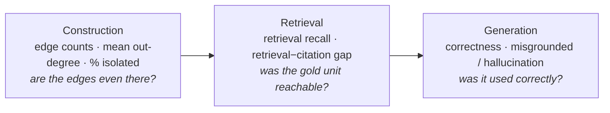

# benchmark.md — the srb-legal-rag benchmark

> One of the **six design docs** ([data_sources](./data_sources.md) · [ingestion_pipeline](./ingestion_pipeline.md) · [knowledge_base](./knowledge_base.md) · [rag_arms](./rag_arms.md) · [ui](./ui.md) · benchmark). Self-contained: the **question design, the difficulty levels mapped to required RAG capabilities, the metrics, the eval methodology, and the scientific framing** — rigorous where it can be, explicit about what it does not establish (§8).

## 1. What the benchmark measures

The same legal question is answered by **five instrumented arms** (context-stuffing · naive · advanced · graph · agentic — [rag_arms](./rag_arms.md)) over **one shared knowledge base** ([knowledge_base](./knowledge_base.md)), and scored side-by-side on **accuracy, provenance fidelity, temporal correctness, latency, and $/query**. The **controlled variable is the corpus** (identical for every arm); the **treatment is the retrieval strategy**. The contribution is not "our system wins" — it is a *reproducible measurement of what each architecture buys and costs* on a low-resource, civil-law, temporally-versioned corpus, including an honest negative result.

**Baseline vs ceiling (the ranking contract).** Four arms are **deployable systems** ranked head-to-head, with **Naive RAG as the primary deployable baseline** — the floor every engineered arm must beat (the standard role of straightforward RAG, e.g. the "straightforward RAG" reference in CRAG, Yang et al., NeurIPS 2024 D&B). The fifth, **context-stuffing, is run as an *oracle*** — **every gold-cited act** is taken from the gold annotation (perfect act selection a priori; non-izreka acts stuff first, CC-decision acts cited only via their izreka last; current consolidations only — version slices excluded) and stuffed whole, in gold order — so it is a **gold-law *ceiling* / skyline**, the retrieval-vs-reasoning upper bound. It is reported prominently but **excluded from the deployable ranking**, exactly as gold-/oracle-context is used as a clearly-labelled upper bound in HotpotQA (Yang et al., EMNLP 2018 — its gold-supporting-fact setting is "an upper bound on performance") and KILT (Petroni et al., NAACL 2021). Treating it as a deployable competitor would be the apples-to-oranges error; treating it as a ceiling is the established, defensible use.

## 2. Question categories (the typology)

Eight typed categories spanning all retrieval capabilities and the two invariants.

| # | Category | Tests | Example |
|---|---|---|---|
| 1 | **single-article (lookup)** | baseline retrieval fidelity | "Шта прописује члан 178 Закона о раду?" |
| 2 | **cross-reference (multi-hop)** | traversal across related articles/laws | "Које услове из ЗОО мора испунити уговор о продаји непокретности?" |
| 3 | **temporal validity** | time-indexed correctness (`as_of`) | "Шта је важило о отказном року на дан 2019-05-01?" |
| 4 | **amendment-diff** | what changed between versions | "Шта се изменило у годишњем одмору између 2014. и 2024?" |
| 5 | **abstain / negative** | safe refusal — repealed or out-of-corpus | "Да ли важи ЗЗПЛ из 2008?" / a question no statute in the KB addresses |
| 6 | **delegated-norm (bylaw)** | answer lives in a pravilnik the law delegates to | "Који је образац / рок / тарифа које прописује правилник на основу члана X?" |
| 7 | **CC validity (`cc_validity`)** | is a provision still in force after a Constitutional-Court strike — requires the CC decision **+** the article | "Послодавац хоће отказ по основу који је Уставни суд оборио — сме ли то?" |
| 8 | **yes/no entailment (`yes_no`)** | a binary decision entailed by the statute (COLIEE Task 4) | "Може ли послодавац да ми откаже зато што сам затруднела?" → **не** (+ the article) |

Two categories carry the project's distinctive load. **delegated-norm** exists because without it naive-flat and graph-hierarchical score nearly identically — the law→bylaw upgrade ([rag_arms](./rag_arms.md)) is invisible unless some gold answers actually live in a bylaw. **cc_validity** directly exercises invariant 2 (it needs the `OCENA_USTAVNOSTI` holding fused with the article); partial-strike ground truth (struck sub-provision vs. re-enactment) rests on the author's own reading of the source and is not expert-validated.

**Voice.** Queries are phrased as **real client questions** — situational, first-person, *without naming the statute or article* ("Покрећем нову фирму — колико дана раније морам да обавестим инспекцију рада?"), not law-school-exam prompts. This stresses retrieval (no lexical gimme of the law name) while keeping each item mapped to the same gold answer.

**Alignment with the field's question typologies** (from a 3-vote-verified survey across LegalBench-RAG, LexRAG, BSARD, NitiBench, LegalSearch-R1, SAT-Graph, COLIEE, VersionRAG):

- **On track.** Single-provision **lookup** is the near-universal backbone (BSARD, NitiBench-CCL are *predominantly* single-label), so the lookup-heavy share is normal, not skewed. The **first-person, statute-unnamed voice** is established practice (BSARD's Droits-Quotidiens questions; LexRAG's pronoun-replaced consultations). Mandatory **citation/provenance** matches NitiBench/SAT-Graph.
- **Genuine differentiators.** **Temporal `as_of`** sits with the 2025–26 frontier only (LegalSearch-R1, SAT-Graph, VersionRAG); **`cc_validity`** appears *unique* (no surveyed benchmark tests "still in force after a CC strike"); **abstain** is a real differentiator (**0 / 8** surveyed legal benchmarks define an unanswerable axis — it's a general-domain convention, CRAG); **delegated-norm** parallels SAT-Graph's hierarchical-impact analysis.
- **Deliberate scope choices.** An optional temporal-recitation slice (LegalSearch-R1 LAR) and multi-turn dialogue are absent by choice, not oversight — the benchmark tests neither.

**Live coverage.** The two shipped situational sets (§5) instantiate **five** of these categories — lookup, cross-reference, temporal, delegated-norm, and cc_validity. The abstain/negative axis has exactly **one item** (e18 — a single-item cell, measured only in that sense: all five arms abstained and scored correct on the headline batch, §9; the 30-item subset carries no abstain item at all, so it cannot exercise this axis); amendment-diff and yes/no entailment are **designed but unpopulated**, so `reports_repeal` cells are empty. Two of the eight categories therefore carry no evidence at all, and a third rests on one item.

## 3. The three difficulty levels — mapped to required capability

Difficulty is **defined by the retrieval capability the answer requires**, not by surface phrasing — the design contract that ties the benchmark to the arms: each level should separate the arms that have the needed capability from those that don't.

| Level | Definition | Capability required | Arm expected to need it |
|---|---|---|---|
| **Easy** | answer in one or two chunks of a **single document** | plain top-k retrieval | naive suffices |
| **Medium** | answer spans **several chunks across ≥2 documents**, or needs the **temporal slice** | hybrid + rerank + **`as_of` filter**; definition-linking (`DEFINED_IN`) | advanced (temporal) / graph (definitions) |
| **Hard** | answer leans on a **peripheral doc** (bylaw / CC decision) **and** spans ≥2 documents — delegated bylaw, multi-law synthesis, or post-CC-strike validity | **hierarchical law→bylaw** (`PRAVNI_OSNOV_ZA` + scoped sub-search) / **validity path** (`OCENA_USTAVNOSTI`) / **cross-law traversal** (`UPUCUJE_NA`) / **agentic planning** | graph / agentic |

**The capability ladder is the hypothesis.** Easy: all arms ≈ equal. Medium: temporal/structural arms pull ahead on dated/definition questions. Hard: the graph + agentic arms should separate from flat arms *if* the structure carries signal — and where it doesn't (cross-reference sparsity), that is itself the measured result (§6).

### Coverage across the ten clusters

The golden set draws from **all ten clusters** so the benchmark reflects the breadth of everyday legal questions and exercises cluster-specific structure:

| Cluster | Difficulty hook it naturally provides |
|---|---|
| 1 Employment & contributions | `doprinosi → PIO` version-skew (amendment-diff + cross-reference); dense bylaw layer (delegated-norm) |
| 2 Family & inheritance | a naturally **closed pair** — each law defines the other's terms (cross-reference, definitions) |
| 3 Real estate, housing, construction | ZOO-backed sale contracts (cross-law); permit procedure delegates to bylaws (delegated-norm) |
| 4 Consumer & everyday transactions | ZOO-central (cross-reference); reklamacija deadlines (temporal) |
| 5 Traffic & misdemeanors | prekršaji penalties (single-article + tariff bylaws) |
| 6 Personal taxes & freelancing | ZPPPA + ZUP procedural closure; paušal rules in bylaws (delegated-norm) |
| 7 Personal data & digital | repeal/abstain (ZZPL 2008), amendment-diff (2008→2018), vacatio legis (digitalna imovina) |
| 8 Business & company life | self-contained company concepts (cross-reference within cluster) |
| 9 Civil disputes & enforcement | the **most connective** cluster — disputes arise in every other cluster (cross-cluster multi-hop) |
| 10 Health, social welfare, benefits | links to employment (contributions) + family; benefit amounts in bylaws (delegated-norm) |

## 4. Metrics (with the literature behind each)

**Answer correctness — reference-guided LLM-as-judge.** A 3-level verdict (correct / partially_correct / incorrect → 1 / 0.5 / 0): reference-guided single-answer grading (**Zheng et al., 2023, *Judging LLM-as-a-Judge with MT-Bench and Chatbot Arena*, NeurIPS**); graded convention follows **RAGAS answer correctness (Es et al., EACL 2024)**. The judge prompt is domain-free (`kl_core.evals`); the runner supplies the model.

**Different-family judge.** The single biggest reviewer objection to an LLM-judge is **self-preference** when judge = generator family (Gemini grading Gemini). The judge is **Claude Opus** (`kl_core.providers.AnthropicLLM`, raw httpx2, no SDK — `claude-opus-5`), a genuinely different family from the Gemini generator and a better grader on this **Cyrillic, low-resource** corpus where partial-credit calls are subtle. The validity claim is **not** "bigger model"; it is **judge–judge agreement**: report Krippendorff's α between the Opus judge and a second-family juror — high cross-family agreement means the ranking is *robust to judge choice*, a stronger argument than the model name. A juror failure never discards a scored item: the primary grade is saved and reported regardless; the item just contributes no agreement pair (logged as a juror error). **The agreement evidence is judge–judge only** — no human-labelled subset exists, so the judge is never anchored to a legal professional's verdict, and a shared machine bias would be invisible to α.

**Statistical rigor — point estimates are not enough.** Architecture rankings off a single seed are not defensible. What the harness does report is **paired significance between arms** (exact McNemar on the per-item correctness vectors — "graph > naive" needs a p-value, not a 0.02 gap), read against **multiple-comparison correction** across the arm matrix (§9). What it does not have is **across-seed replication**: every campaign is single-seed, so no point estimate here carries a confidence interval or a known run-to-run spread, and all of them are labelled **indicative**.

**Provenance fidelity — deterministic citation precision / recall / F1.** Predicted citations (`source_id::fragment`) vs gold, no judge in the loop — the **ALCE citation-quality protocol (Gao et al., EMNLP 2023)**. The metric no commercial Serbian competitor has independently demonstrated.

**Retrieval recall / precision — deterministic, retriever-side.** The arm's *retrieved pool* (every unit fed to the generator, pre-citation) keyed exactly as gold/predicted citations, compared against gold. The headline is the **retrieval−citation gap** (`retrieval_recall − citation_recall`): it splits "the retriever never surfaced the gold unit" from "the retriever surfaced it but the generator didn't cite it" — the decomposition the GraphRAG negative result needs (§6). Precedent: LegalBench-RAG (Pipitone & Houir Alami 2024, retriever-side P@k/R@k at minimal-span granularity); the "**answer string appears in the retrieved context**" coverage metric (Xiang et al., *When to use Graphs in RAG*, arXiv 2506.05690) and **GraphRAG-Bench Evidence Recall** (Xiao et al., arXiv 2506.02404) are the same construct; **HippoRAG All-Recall** (Gutiérrez et al., arXiv 2405.14831 — % of queries where *every* gold passage is retrieved) is exactly the **all-of** reachability diagnostic (§5). Implemented in `kl_core.evals.score_item(retrieved_keys=…)`; the runner builds keys from `result.retrieved` via the same `_provenance` mapping as predicted citations, so the two recalls are strictly comparable.

**Misgrounded / hallucination rate — deterministic.** Follows **Stanford RegLab (Magesh et al., *Hallucination-Free?*, J. Empirical Legal Studies 2025)**: a *delivered* answer is **hallucinated iff incorrect OR misgrounded**, where misgrounded = cites sources that don't support the claim or are inapplicable. **Misgrounded is deterministic and single-limbed: every cited unit lies outside the gold set (`citation_precision == 0`).** It is deliberately kept **independent of the temporal axis**. Folding `temporally_wrong_and_cited` into it (the earlier design) made the two non-independent, so a defect in either contaminated both — with a temporally-naive arm, *every* misgrounding it recorded was the temporal flag and nothing else, which reads as a grounding property and is not one. `temporally_wrong_and_cited` — an in-force-mode answer resting on a unit out of force on `as_of`, cited *as authority* (the civil-law analog of RegLab's "**overruled case = misgrounded**") — is reported as its own axis, the number that operationalizes invariant 2.

**Denominators are fixed, and refusal is priced exactly once.** All three safety rates are computed over *every answerable item*, not over the subset an arm chose to deliver. A delivered-only base silently rewards refusal — an arm that abstains more shrinks its own denominator — and makes arms with different abstention rates non-comparable. Refusal is penalised in one place only, `over_abstention_rate`; the delivered-base rate and the delivered/answerable counts are reported alongside so both readings are visible. Hallucination itself stays scoped to delivered answers (a refusal is not a false statement), while **`misgrounded` and `temporally_wrong_and_cited` are graded whenever an answer carries citations — including a citing abstention**: "I can't determine this, but see član X" where X is repealed is the invariant-2 hazard in its purest form, and gating on delivery made those citations unscoreable. Partial-credit answers are not counted as incorrect (the strict-incorrect limb uses `correctness == 0`). Note: RegLab nests groundedness within correctness; ours is deterministic and orthogonal — frame it as the *stronger* split, not as the paper validating an orthogonal version verbatim.

**Abstention quality — deterministic, split.** Beyond binary abstain accuracy: **over-abstention** (refused an answerable item) and **false-answer-on-unanswerable** (answered an abstain target) reported separately, motivated by RegLab's finding that legal LLMs are poorly calibrated (over-trust + under-refuse / sycophancy on false premises). Full risk-coverage/AURC curves would need a per-answer confidence signal the arms do not emit, so they are not reported.

**Graph-construction structural stats — deterministic, answer-independent.** Node/edge counts by type, **mean out-degree**, **% isolated nodes**, cross-law edge density and `arm_reachable_pct` — read from `graph_stats.json`, surfaced in the eval report when a structural arm runs. These follow **GraphRAG-Bench**'s construction-stage metrics (Xiao et al., arXiv 2506.02404 — Node Count, Edge Count, Average Degree, "Organization" = non-isolated fraction) and are the *construction stage* of the negative-result decomposition (§6): they turn "the cross-law edges don't exist" into reported numbers, read alongside the retrieval-recall split.

**Temporal correctness — deterministic.** Every cited unit's `[valid_from, valid_to]` must cover the item's `as_of`. `TaskItem.temporal_mode` distinguishes **`in_force`** (every cited unit must be in force on `as_of`) from **`reports_repeal`** (an out-of-force citation is *not* penalized — the answer is reporting the repeal, citing the article as the *subject* of a temporal claim, not as current authority).

**Abstain accuracy — deterministic** (no LLM): correct iff the system abstained on an abstain-target item.

**Latency & $/query — instrumented** per stage and per run (mandatory in every `ArmResult`).

**Framing references.** Harness shape follows RAGAS-style task-grounded metrics; the LLM-judge-as-auditor pattern is anchored in the **Stanford RegLab legal-hallucination auditing** methodology; the temporal-validity framing follows **SAT-Graph RAG (de Martim, 2025)**, which explicitly calls point-in-time legal retrieval "a notable gap".

## 5. Evaluation methodology

**Harness (`kl_core.evals` + `lexsr.evals`).** `score_item(item, answer, backend, judge, latency, cost, retrieved_keys) → ItemScore`; `aggregate(scores) → per-arm metrics`; `_aggregate_by(scores, …) → tier × arm` and **capability × arm** matrices. The runner persists every run to telemetry (`runstore.save_run`), writes the graded `ItemScore` back (`set_eval`), and emits two Markdown reports (`summary_*.md`, `raw_*.md`). Batch runs (`lexsr.bench`) launch on a background thread with live progress; each carries a `batch_id`, each manual ask buckets under `interactive`.

**`TaskItem`**: `item_id`, `query` (text, `as_of`, filters), `category` (difficulty tier), `capability`, `temporal_mode`, `gold_answer` (None ⇒ abstain target), `gold_citations` — `source_id::član N`, optionally **`@version`-pinned** — and the `reachable_by_flat_topk` / `flat_topk` diagnostic labels (below). Citations are graded by **subsumption** (`citation_keys`): an unpinned gold citation matches *any* version of that article, which is the right default since most articles were never amended; a pinned one matches exactly one slice, and is how a temporal item states which text it means. Without pinning the whole provenance family is period-blind — an article and all its slices collapse to one key, so citing the 2022 text for a 2018 question scores a perfect hit. Keeping unpinned citations valid is what makes pinning non-breaking: previously-authored goldens keep their semantics and stay comparable across campaigns. **`ItemScore`**: correct, correctness, provenance_fidelity (F1), citation_precision/recall, retrieval_recall/precision, temporally_correct, temporally_wrong_and_cited, misgrounded, hallucinated, abstained, abstain_target, latency_ms, cost_usd, judge_rationale, judge_model.

**Golden sets.** A golden set is one `*.jsonl` file under `goldens/`; the benchmark scopes everything — the question editor, the run target, the metrics filter — to a chosen set, so several coexist and compare head-to-head. The live sets:
- **`golden-situational-60.jsonl` — the default set.** Concrete first-person client questions about a real problem, where the **tier is the citation doc-spread** (§3; abstain items — no gold answer, no citations — are exempt from the spread rule). Balanced **20/20/20**. Authored over grounded anchors so each gold answer is the join of grounded sub-answers and `bench.validate_item` (grounding) passes by construction; locked by `test_situational_goldens_contract`. The hard tier is **spread across ~10 clusters** (employment-contributions, workplace-safety, construction, cadastre, consumer, traffic, tax, business, health, family) + `cc_validity` + a small notary set — not concentrated in one domain. Ten items have been corrected since the set was built — most notably h02, whose earlier gold *inverted* the Constitutional-Court holding it cites (the Court struck only the budget-sector exemption inside čl. 14а st. 1 t. 2, leaving the housing benefit taxable), and e18, the set's one **abstain target** (the KB cannot ground the 2017 pension-adjustment rule — see the `@version` citation gap, §9). Because the gold changed, per-item scores are comparable only between runs judged against the same revision of the set. **60 items is a small set**: each difficulty tier holds 20, and the capability cells are far smaller (cc_validity n = 3, abstain n = 1 — §9), which bounds what any single comparison drawn from it can establish.
- **`golden-situational-30.jsonl` — the dev subset.** A balanced **10/10/10** strict subset of the 60 for cheap iteration; shared items are content-identical by contract test (corrections mirrored into both).

**The two run profiles actually used.**
- **Iteration profile:** `golden-situational-30`, the **4 deployable arms** (naive · advanced · graph · agentic — the context-stuffing oracle is run only in headline campaigns), **single seed**, **Opus judge** (`claude-opus-5`). Cheap enough to iterate freely; its numbers are **indicative**, and it contains no abstain item, so that axis is untestable on it (§2).
- **Headline profile:** `golden-situational-60`, **all 5 arms incl. the stuffing ceiling**, **single seed**, Opus judge plus a second-family juror for Krippendorff's α. Every number reported in §9 comes from this profile.

Both profiles are single-seed; neither yields a variance estimate.

**The construction charter — fairness is symmetry.** Rigging *for* GraphRAG (selecting questions it must win) and discriminating *against* it (constructing a set where structure can never matter) are the same sin in opposite directions; the defense against both is identical. Every item is built to:
1. **Source-authored, blind to any arm's output** — gold comes from reading the statute/bylaw, never from copying a retriever's hits (removes vector-findability circularity, neutrally).
2. **Client-voice phrasing, applied uniformly** — the *situation's* vocabulary, not the statute's wording, on **every** item. (Without this, lexical overlap hands naive RAG a free win and traversal never matters — the biggest anti-graph bias.)
3. **Structurally-rich questions at their *natural* rate** — delegated-norm, cross-reference, cc_validity appear because real users ask them; *excluding* them would discriminate, *over-weighting* them would rig.
4. **Complete gold citations** — list *every* unit a correct answer must rest on (article **+** bridge reference **+** CC `izreka`), so the provenance/temporal metrics register where each arm rested.
5. **Identical pipeline + equal retrieval budget across arms** — same corpus, chunking, `as_of`, `k`, model, temperature; the *only* treatment is retrieval strategy. (A too-large `k` is a subtle anti-graph bias — selectivity stops mattering.)
6. **Symmetric reachability diagnostic** (below) — read both ways: flag flat-reachable items (leakage) *and* warn if the whole set is flat-reachable (graph never got a chance). **Report, never select.**
7. **Provenance + temporal metrics as the honest discriminator** — on cc_validity a flat retriever produces a fluent, confident, *wrong* answer (cites a struck article as in force — the invariant-2 failure) while a structure-aware arm catches it; the deterministic citation/temporal metrics surface that even when the answer *text* looks similar.

**Gold-answer grounding (`bench.validate_item`).** Beyond "every citation resolves to a non-empty chunk", a gold answer must be **lexically grounded in its cited article** — content-word recall ≥ 50% (`grounding_overlap`) against the union of cited article texts (skipped only when chunk text isn't loadable, or for abstain items). This converts "trust the AI draft" into *"every gold answer is verifiably supported by the verbatim statute it cites"* — the closest mechanical substitute for expert review. It eliminates fabrication and citation-drift; it does **not** catch legal-interpretation error, and that residual is unaddressed — a gold answer can be verbatim-supported by the article it cites and still read the law wrong.

**Vector-reachability diagnostic (`lexsr.diagnose`, label not filter).** For each item, run flat top-k retrieval on the question and record **per gold citation** whether each required unit is in top-k. An item is `reachable_by_flat_topk` only when flat surfaces *every* gold citation (**all-of**, not any-of), with `flat_topk = {hits, misses}` as reviewer-legible evidence. All-of is deliberate: a multi-cite `cc_validity` item only "gives graph no chance" when flat already has the discriminating `izreka`, not merely the article. This is standard **leakage/difficulty hygiene** (QA benchmarks routinely check lexical-overlap findability), reported in the methods section — **never** used to include/exclude an item. It detects construction bias in *both* directions and emits a set-level warning when ≥90% of answerable items are fully flat-reachable (graph never got a chance).

**Pre-registration of per-capability hypotheses.** Before a run, commit the expected pattern — *ties on lookup; graph/agentic advantage on delegated-norm + cc_validity **if** structure carries signal; cross-reference likely flat by corpus sparsity* — then report **every** stratum. Pre-commitment + per-stratum reporting is the meta-defense that makes the set immune to both the rigged-for and rigged-against accusation.

**What the methodology does not include.** Cross-family judging and judge–judge agreement are in place; there is **no judge–human validation** — no expert-labelled subset and no human-agreement coefficient. Gold answers are **source-authored and mechanically grounding-checked, never reviewed by a Serbian legal professional**, so there is no inter-annotator κ and no dataset card. Runs are **single-seed**. For all three reasons the numbers are labelled **indicative** wherever they appear.

## 6. The GraphRAG negative result — the headline finding

The benchmark is built to answer: *does typed structure differentiate from flat retrieval, and where?* What this corpus gives back is a **negative result on cross-reference multi-hop**, decomposed by pipeline stage so it reads as a located finding rather than a bare "graph lost".

**Why cross-reference GraphRAG has little to traverse (corpus-intrinsic).** Serbian statutes — especially civil codes — **rarely cite each other by article number** (of the ZOO's ~1,097 articles, only 12 carry a numbered cross-reference at all — and not one points outside the ZOO). On a static single-consolidation corpus the numbered cross-reference web (`UPUCUJE_NA`) is therefore intrinsically sparse: most articles have no outgoing edge, and the few cross-law edges that exist often point at a degenerate-title or version-skewed target. Manufacturing those edges would be fabrication; the sparsity is a real, measurable property of the corpus (reported via the construction-stage stats, §4). This is *partly intrinsic* (civil-law drafting style) and *partly a fixable artifact* (version skew — real `doprinosi → PIO` references point at PIO article numbers absent from the pinned consolidation).

**Where structure can still earn its keep.** The graph arm does not depend only on `UPUCUJE_NA`. Its value is **definition-/hierarchy-/validity-aware traversal**: term-aware `DEFINED_IN`, the law→bylaw hop (`PRAVNI_OSNOV_ZA`), and the constitutional-validity path (`OCENA_USTAVNOSTI`) — relationships that *do* exist in the corpus. The hypothesis under test is that the graph/agentic arms separate from flat arms on the **delegated-norm + cc_validity** tiers, not on cross-reference multi-hop — "structure earns its keep *here*, not *there*".

**What the measurement shows (§9).** On **cc_validity** (n = 3 — direction only) the engineered arms sit at 2–3/3 vs naive 2/3 — no measurable separation at this cell size; whether the validity path's edges convert into accuracy on a larger cell is unknown, and nothing here demonstrates that they do. On **delegated-norm** (n = 17) — the tier built to reward the law→bylaw hop — every engineered arm clears naive (agentic 13/17, advanced 11/17, graph 9/17 vs naive 5/17), but the *fixed-pipeline* hop underperforms flat retrieval while the adaptive arm leads: graph−advanced there is 2 discordant items, p = 0.50 — not an effect. The mechanism reading — structure cannot convert the available hierarchy into a real lead because the bottleneck is the **non-relevance-ranked law→bylaw fan-out** (§9), not the gate or the reader (both ablated to no effect) — rests on the retrieval diagnostic. So the negative result is not only "graph ≈ naive on cross-reference (sparsity)" but the sharper "with seeds *and* reader held equal, typed structure ≈ strong flat retrieval" — the graph−advanced delta sits inside paired-McNemar noise (2/4 discordant, p = 0.6875).

**Decomposing the result by pipeline stage.** The defensible way to report "GraphRAG ≈ naive" is to attribute it to a *stage*, mirroring the field — GraphRAG-Bench (Xiao et al., arXiv 2506.02404) decomposes into construction → retrieval → generation, and "When to use Graphs in RAG" (Xiang et al., arXiv 2506.05690) root-causes underperformance at **construction** (answer entities never enter the KG). Our decomposition:

- **Construction** — answer-independent structural stats (edge counts by type, mean out-degree, % isolated nodes) in the GraphRAG-Bench idiom: turns "the edges don't exist" into a number.
- **Retrieval** — **retrieval recall** + the **retrieval−citation gap** per capability: was the gold unit *reachable* for the structural arm at all, separating "edge-starved" from "generator under-cited". HippoRAG **All-Recall** ≙ the all-of reachability diagnostic; SubgraphRAG and HippoRAG report recall **by hop count** — the per-capability table is the same cut.
- **Generation** — correctness + the misgrounded/hallucination rates.

So the result is not "graph lost" but "graph *couldn't* win on cross-reference because construction-stage edge density is intrinsically low, and retrieval-stage recall shows the gold unit was never reachable — while on delegated-norm/cc_validity, where the hierarchical/validity edges are dense, it can separate."

**Construction validity — is the negative result an artifact of how the golden was built?** A fair question: an AI-authored golden implicitly selected for *findability* would be biased toward vector-friendly items, and graph could never win — a confound, not a result. The decomposition is honest. Part of "graph doesn't differentiate" is **corpus-intrinsic** ( — the edges genuinely don't exist) and stands as a real finding. The **construction-induced** part is controlled — not by redesigning questions so graph must win (the opposite rig), but by the **construction charter (§5)**: source-authored-blind gold, uniform client-voice phrasing, structurally-rich questions at their natural rate, complete gold citations, equal pipeline/budget, and the symmetric reachability diagnostic read both ways (label, never filter; hypotheses pre-registered). The cleanest evidence the set is **not** rigged for graph is a negative result itself — a graph-favouring benchmark could not produce "graph ≈ naive, lower on hard".

## 7. Landscape positioning — the novelty triangle

Three axes; every comparable covers at most two corners.

| Benchmark | Low-resource civil-law | Temporal validity | Architecture comparison |
|---|:--:|:--:|:--:|
| NitiBench (Thai) | ✅ | ❌ | ◑ (RAG vs long-context only) |
| "Can LLMs Time Travel?" (Chinese) | ◑ | ✅ | ❌ (single RL method) |
| SAT-Graph RAG (Brazil) | ✅ | ✅ (design) | ◑ (GraphRAG only, **no empirical eval**) |
| UA-Legal-Bench (Ukrainian) | ✅ (Slavic) | ❌ | ❌ (LLMs only) |
| BSARD (Belgian French) | ◑ | ❌ | ❌ |
| LexRAG (Chinese) | ❌ | ❌ | ◑ |
| **srb-legal-rag** | ✅ | ✅ **(empirical)** | ✅ **(five arms)** |

Adjacent prior art the demo positions against: **LexGLUE, LegalBench, LEXTREME, MultiEURLEX** (pre-RAG NLU; LEXTREME covers Croatian/Slovenian as EU-official but **excludes Serbian/BCMS**), **COLIEE** (statute/case retrieval, not temporal/low-resource), **LegalBench-RAG / RIRAG-ObliQA** (retrieval-centric, no temporal), **NER4Legal_SRB** (Serbian NER, not RAG). The Serbian-language, temporally-versioned, architecture-comparison intersection is empty — srb-legal-rag's slot.

## 8. What this evaluation does not establish

This is an exploratory study on one corpus. The following are the limits a reader should carry into every number in §9.

1. **Nothing is externally preregistered.** Per-capability hypotheses are pre-committed in this doc (§5) and every stratum is reported, but the pre-commitment rests on this repo's own history — there is no independent registry entry, so "pre-registered" cannot be claimed against an outside record.
2. **The gold set is not expert-validated.** No Serbian legal professional reviewed the items; there is no inter-annotator κ and no dataset card. The mechanical grounding check (§5) verifies that each gold answer is lexically supported by the article it cites — it cannot catch a wrong legal reading of a correctly-cited article.
3. **Baselines are internal only.** Five arms over one shared KB. No external system (LightRAG, Microsoft GraphRAG, fast-graphrag) and no closed-book / no-retrieval lower control were run, so the deployable arms are bracketed from above by the oracle ceiling and from below by nothing.
4. **Single seed, no variance estimate.** Paired exact McNemar and a Bonferroni correction across the arm matrix are reported (§4/§9), but there is no across-seed replication, so no point estimate carries a confidence interval. Run-to-run instability on this stack is not hypothetical — it is measured (~6% correctness-flip between two runs of the same prompts, §9) — which is exactly why a single-seed ranking cannot be read as an effect.
5. **Judge validity rests on judge–judge agreement alone.** The cross-family Opus judge (`claude-opus-5`) plus a second-family juror give Krippendorff's α = 0.764 on the headline batch — **below the conventional 0.80 reliability threshold**, and anchored to no human labels, so a bias shared by both model families would not show up.
6. **Provenance fidelity is measured, but recall-bound.** The citation P/R/F1 metric is deterministic and reproducible; on this corpus it is limited by retrieval recall rather than by generator citing behaviour (§9), so it does not currently discriminate between the arms' *citing* quality.
7. **The negative result is single-corpus and single-seed.** It is decomposed by pipeline stage, its construction validity is controlled by the symmetric charter (§5/§6), and it holds across generator, judge, gold version and scorer. All of that is still one 60-item set over one Serbian statute corpus, with one graph construction — it says nothing about other corpora, other graph designs, or larger item counts.
8. **The typology is only partly instantiated.** Two of the eight question categories carry no data at all (amendment-diff, yes/no entailment), the abstain axis rests on a single item, and cc_validity holds three (§2/§9). Whatever those cells would have shown, this evaluation does not say.

## 9. Open questions & consequences

- **The GraphRAG negative result (current-state, triangulated).** With the graph arm's seeds *and* within-bylaw reader held equal to advanced's hybrid pipeline, typed structure **neither beats nor hurts strong flat retrieval** on this corpus. On the headline batch (`golden-situational-60`, 5 arms, `gemini-3.6-flash` generator, Opus 5 judge + Gemini juror, 300 answers / 0 errors, **α = 0.764**, $20.91 — [report](../benchmarking/benchmark_report_situational_60_5arm_20260808.md)): **Agentic 0.87 > Advanced+Graph 0.77 ≈ Advanced 0.73** (graph−advanced 2/4 discordant, **p = 0.6875**; agentic−advanced 2/10, **p = 0.0386** — significant uncorrected, *not* after Bonferroni across six pairwise tests) while **all three significantly beat Naive 0.48** (paired exact McNemar, p ≤ 0.0003); the all-gold-acts Context-Stuffing ceiling reaches **0.92** at 12.8× naive's cost while staying temporally blind by construction — and is now statistically **indistinguishable from agentic** (3/6 discordant, p = 0.508). The graph≈advanced equivalence is **robust to generator, judge, gold-version and scorer choice** (four campaigns with a reported significance test, two generators, two judges, three gold versions, two scorers), and here graph is nominally *ahead*, which makes the ordering visibly noise rather than a stable small gap. On the delegated-norm tier the adaptive arm leads (agentic 13/17) while the *fixed-pipeline* hop underperforms flat retrieval (graph 9/17 vs advanced 11/17) — the hop as a pipeline stage costs what it gains, and only a planner invoking it selectively profits. Reviewer-proof by construction: the equivalence guarantee (structure-off ⇒ graph ≡ advanced — rag_arms §6) rules out an under-built arm, the ablation attributes the non-effect to the hop, and the cause is a measured corpus property (next bullet). It remains single-seed and therefore **indicative**, and **α is below the 0.80 reliability threshold** (0.764 nominal; 0.842 ordinal, 0.781 binarised). The disagreement is 81% correct-vs-partial and directional, and the ranking plus every engineered-vs-naive p-value are unchanged when re-derived from the juror's labels — so the grades are moderately reliable on the boundary and robust on the ordering (§8).
- **Temporal correctness is demonstrated, not measured — and the metric that appears to measure it does not.** On answered dated queries the validity-filtered arms commit zero `temporally_wrong_and_cited` failures while naive fails 1 of 2 and the oracle 2 of 2. That split is **arm configuration, not an effect**: naive and the oracle both retrieve with `is_version_slice = false`, so where the in-force text at `as_of` *is* a superseded slice they cannot cite it, while the filtered arms filter to in-force-at-`as_of` before generation and so cannot cite an out-of-force one. Neither outcome could have come out otherwise. What the campaign supports is a **deterministic mechanism demonstration** of the invariant-2 hazard, not a measured rate — and the dated cell has an **effective n of 1** (two of its three items are correct for all five arms). No measured temporal effect exists here: separating one would require a dated tier built over *materially amended* articles with period-pinned citations, and this set does not contain one.
- **Why the hop can't help: the unordered law→bylaw fan-out.** A three-stage retrieval diagnostic isolated the bottleneck — not the **gate** (loosening `delegation_gate` left gold-bylaw-in-pool unchanged), not the **reader** (equalizing the scoped sub-search to hybrid left it unchanged), but the **non-relevance-ranked `LIMIT` fan-out**: Serbian laws delegate to *many* bylaws (up to **79** materialized corpus-wide, **62** on the delegated-norm tier), so the handful searched usually excludes the gold bylaw. Reaching it would mean **relevance-ranking the fan-out — which is retrieval, the thing advanced already does corpus-wide** — so the hierarchical edge adds no retrieval power flat retrieval doesn't already have here. The fan-out is left unranked, and this set could not adjudicate a fix even if one were made: its delegated-norm items have been error-analyzed item by item, so any change tuned against them would be contaminated — a clean verdict would need held-out data and the `bylaw_hop` ablation (rag_arms §7) to attribute it.
- **The generator is unpinned — cross-time runs are drift-confounded.** The generator default (`gemini-3.6-flash`) is a **floating alias**, and the class of risk is measured on its predecessor: a generator-shift analysis found, on byte-identical prompts across two `gemini-3.5-flash` runs, 48/53 different answer texts, a ~6% correctness-flip rate, and an early-quit abstention mode traced to silently-unparseable decision calls (not a policy shift; since covered by the retry layer). The harness contains the *transient* failure modes (retry ≤3 with one 2× cap escalation, the no-conclusion-without-research guardrail, `seed_search`, generation failures scored as batch errors — [rag_arms.md](./rag_arms.md) §3/§6), but drift itself is uncontrollable without pinning, and the API offers no dated snapshot alias to pin. Consequence: only same-day comparisons within one contiguous campaign are sound — every headline number in this section is drawn that way — and **no cross-time trend across this repo's run history can be read as an effect**, because generator, embedder and judge were never frozen together.
- **Provenance is recall-bound, not citation-bound.** The retrieval−citation gap stays small on the headline batch (0.025–0.054 on the four deployable arms; the **oracle** is the outlier at 0.092 — with retrieval recall 0.966 by construction its residual gap is pure citation selectivity): citation recall **0.530–0.874** tracks retrieval recall **0.555–0.966**, so prov.F1 (**0.456** naive → **0.611** agentic) is limited because the gold unit isn't *retrieved*, not because the generator under-cites — the decomposition the metric set (§4) was built to expose. All remaining headroom is recall, principally the delegated-norm fan-out.
- **Structure's remaining home turf is definition-/validity-aware traversal, not citation multi-hop** (§6) — the `OCENA_USTAVNOSTI` validity path and term-aware `DEFINED_IN` traverse relationships that genuinely exist. But the supporting cc_validity cell does not separate at all (graph and agentic 3/3, advanced/naive/oracle 2/3 — n = 3, **direction only at best**); at that cell size no separation could be detected either way, so the traversal-value claim rests on the mechanism and not on this evidence.
- **Agentic leads on quality; its accuracy lead does not survive multiple-comparison correction, at ~2.3× advanced's cost.** On the headline batch agentic tops accuracy (**0.867**; +0.133 over advanced, **2/10 discordant, p = 0.0386** — clears neither Bonferroni (α = 0.0083) nor Holm (α = 0.0167) across the six deployable pairs), correctness (**0.933**), provenance F1 (**0.611**), hallucination (**0.068**, lowest of any arm; misgrounding 0.068, tied with the oracle), and records **zero over-abstentions** (0/59 answerable items refused). Its lead spreads across both discriminating tiers — medium 16/20 vs advanced's 12/20, hard 16/20 vs 13/20, where it equals the oracle. The claims the data supports are correctness, safety and abstention; **the accuracy lead is not established at a single seed with judge agreement below threshold**.Residual failure modes were decomposed in a per-item failure analysis; the eviction-bug family it identified is fixed and validated (that campaign's +7/−2 flip pattern on exactly the targeted items). The graph arm keeps `temporally_wrong_and_cited = 0` (its `_smart_retrieve` seeds carry the in-force filter; the cc-validity `izreka` stays deliberately exempt — a holding *reports* a strike).
- **Reachability hygiene holds.** `lexsr.diagnose` (all-of; the diagnostic mirrors the naive arm exactly, incl. its version-slice exclusion), labels computed on the current sets: **40.7% / 40%** of answerable items are fully flat-reachable (`golden-situational-60`, 24/59 · `-30`, 12/30) — well under the 90% "graph never got a chance" warning; on the **delegated-norm tier only 1/17 (60) and 0/8 (30)** are flat-all-reachable, so the law→bylaw hop is genuinely *required* there. Every situational delegated-norm item is built as a law anchor ⊕ bylaw anchor (≥2 citations, so any-of ≠ all-of); the reachability label, not item selection, carries the finding (charter rule 6).
- **The live sets instantiate five of the eight categories** (§2) plus a single abstain item (e18) — the `false-answer`-on-unanswerable axis is now **measured, single-item**: all five arms abstained on e18 and scored correct (indicative — n = 1); amendment-diff and yes/no are unpopulated. Nothing about abstention behaviour beyond that one item is established, and the two empty categories carry no evidence at all.
- **Two arms cannot cite a version slice at all, by design — so their temporal numbers are configuration, not measurement.** `naive` and the `context-stuffing` oracle both retrieve with `is_version_slice = false` (naive because a real naive deployment would not index slices; the oracle because it stuffs whole current acts). Where the text in force at `as_of` *is* a superseded slice, neither arm can reach it, so each fails `temporally_wrong_and_cited` deterministically — while advanced/graph/agentic, which filter candidates to in-force-at-`as_of` before generation, pass it just as deterministically. A cross-arm "split" on this metric therefore restates the arm configuration and must be reported as a **mechanism demonstration, not a measured effect**. What the metric *does* measure honestly is within-arm: whether an arm that can reach the right slice actually cites it.
- **Temporal metric — authority vs subject-of-claim.** Handled by `temporal_mode` (§4); the remaining subtlety (mixed answers that both rely on a current article and report a repeal) is left to per-item annotation.
- **Agentic-trajectory + dedicated temporal-QA metrics** (tool-call efficiency, step count, trajectory correctness; point-in-time-retrieval-specific scores) are recommended in the literature but are neither sourced to a named benchmark here nor implemented — agentic trajectories are logged but not scored, so the agentic arm's *process* is unmeasured even where its answers are graded.
- **Risk-coverage / AURC** abstention curves need a per-answer confidence signal the arms do not emit; without it the abstention picture is limited to the three deterministic rates in §4.
- **Partial-strike `cc_validity` ground truth** (struck sub-provision vs. re-enactment) needs expert validation — h02 is the concrete case: a partial strike (the exemption clause inside čl. 14а st. 1 t. 2) is easily misread as a whole-point annulment, exactly the failure mode expert review would catch and the grounding check cannot. The corrected items (h02, m02, h16, m07/m18/m19, e12, e18, e17, e20) are the ones whose ground truth rests entirely on the author's own reading of the source — one of them (h02) was already wrong once.
- **Consequence — oracle act selection is the benchmark's largest measured effect.** The single-act→all-gold-acts oracle correction moved the ceiling 0.42 → 0.93 (+0.52): knowing *which acts* to read is worth more than any retrieval-stage refinement measured here, which is the cleanest quantification of why multi-act retrieval is the problem that matters on this corpus. The correction was made and disclosed the same day; the affected rows carry `oracle_variant` markers, so pre- and post-correction oracle numbers are distinguishable but not interchangeable.
- **Consequence — single-seed numbers are indicative.** Same corpus, single seed, source-authored (grounding-checked, not expert-validated) gold. §8 states what that leaves unestablished; the demo labels the numbers accordingly.

## 10. References

Metrics & eval methodology — Zheng et al., *Judging LLM-as-a-Judge with MT-Bench and Chatbot Arena*, NeurIPS 2023 D&B (LLM-as-judge; position/verbosity/self-preference bias — basis for the different-family judge); Es et al., *RAGAs*, EACL 2024 (graded answer-correctness); Saad-Falcon et al., *ARES*, NAACL 2024 (automated RAG eval). Inter-rater agreement & significance — Krippendorff, *Content Analysis* (α as the judge–judge / inter-annotator coefficient); Dietterich, *Approximate Statistical Tests…*, Neural Computation 10(7) 1998 (McNemar for paired arm comparison); Efron & Tibshirani, *An Introduction to the Bootstrap*, 1993 (bootstrap CIs). Dataset documentation — Gebru et al., *Datasheets for Datasets*, CACM 2021. Citation / attribution — Gao et al., *Enabling LLMs to Generate Text with Citations* (ALCE), EMNLP 2023; Liu et al., *Evaluating Verifiability in Generative Search Engines*, Findings of EMNLP 2023; Rashkin et al., *Measuring Attribution in NLG* (AIS), Computational Linguistics 49(4) 2023. Oracle / gold-context upper bound — Yang et al., *HotpotQA*, EMNLP 2018; Petroni et al., *KILT*, NAACL 2021. Temporal QA — Dhingra et al., *TempLAMA*, TACL 2022; Zhang & Choi, *SituatedQA*, EMNLP 2021; Kasai et al., *RealTime QA*, NeurIPS 2023 D&B. Legal NLP / RAG landscape — Chalkidis et al., *LexGLUE*, ACL 2022; Guha et al., *LegalBench*, NeurIPS 2023 D&B; Hendrycks et al., *CUAD*, NeurIPS 2021 D&B; Niklaus et al., *LEXTREME*, Findings of EMNLP 2023 & *MultiLegalPile*, ACL 2024; Pipitone & Houir Alami, *LegalBench-RAG*, arXiv 2024; Yang et al., *CRAG*, NeurIPS 2024 D&B; Magesh et al., *Hallucination-Free?*, J. Empirical Legal Studies 2025. Retrieval-stage decomposition & GraphRAG negative-result precedent — Xiao et al., *GraphRAG-Bench*, arXiv 2506.02404 (Context Relevance + Evidence Recall; construction stats; stage-decomposed pipeline); Xiang et al., *When to use Graphs in RAG*, arXiv 2506.05690 ("answer string in retrieved context"; construction-stage root cause); Han et al., *RAG vs. GraphRAG: A Systematic Evaluation*, arXiv 2502.11371 (flat-vs-graph comparison precedent); Gutiérrez et al., *HippoRAG*, arXiv 2405.14831 (All-Recall; path-following vs path-finding); Luo et al., *SubgraphRAG*, arXiv 2410.20724 (Answer Entity Recall; recall by hop count); Wallat et al., *Correctness is not Faithfulness in RAG Attributions*, arXiv 2412.18004 (citation correctness vs faithfulness).
