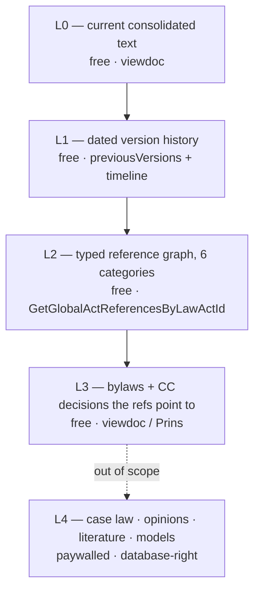

# data_sources.md — where the knowledge base comes from

> One of the **six design docs** (data_sources · [ingestion_pipeline](./ingestion_pipeline.md) · [knowledge_base](./knowledge_base.md) · [rag_arms](./rag_arms.md) · [ui](./ui.md) · [benchmark](./benchmark.md)). Self-contained: this doc fully describes the **sources, the depth levels available, the access tier we use, and the file/content types we read**. Downstream: the ingestion pipeline consumes everything here.

## 1. The single source: Pravno-informacioni sistem RS (PIS)

All statutory data comes from the **official state Legal Information System**, `pravno-informacioni-sistem.rs` (PIS RS), run by JP Službeni glasnik. We deliberately use **only PIS** — never commercial aggregators (Paragraf, Intermex) — because PIS is authoritative, free, and legally clean to redistribute.

The public website is a JavaScript shell; the data lives in the backing JSON/HTML APIs the app calls. We talk to those APIs directly (discovered by reading the app bundles) — server-rendered, semantically-classed HTML supports structure-aware parsing, which is what reliable legal retrieval depends on (structure-aware chunking outperforms sequential splitting for statutes — Fadillah et al. 2026, *Data Technologies & Applications*; document-level retrieval mismatch in legal RAG — Reuter et al. 2025, NLLP@EMNLP).

### Hosts

| Host | Purpose |
|---|---|
| `reg.pravno-informacioni-sistem.rs/api/` | the registry + consolidated-text + reference-graph APIs (the workhorse) |
| `di.pravno-informacioni-sistem.rs/` | advanced title search (`REG/advancedSearch`) |
| `slgl.pravno-informacioni-sistem.rs/api/` | the **Prins** service — ELI resolution + acts that registry search can't see (repealed laws, CC decisions, authentic interpretations, gazette amendment acts) |
| `fp.pravno-informacioni-sistem.rs/api/` | site-content Prins service (static pages — serves the *Uslovi korišćenja* document, §6; not used by the crawler) |
| `sp.` / `mml.` / authenticated `regulations.` | **paywalled** — case law, opinions, legal literature (L4, out of scope; see §4) |

### Endpoint map

| Endpoint | Host | Returns |
|---|---|---|
| `REG/advancedSearch` (POST) | di | title → registry hits (law guid + current regactid + gazette-chain title) |
| `GetLawActViewByGuid?guid=` | reg | a law's current version + `previousVersions[]` |
| `GetLawActTimeline?guid=` | reg | per-version `versionApplicationDate` (the dates) |
| `GetEliInfoByGuid?guid=` | reg | canonical ELI URI for a law |
| `prins/eli/<path>` | slgl | ELI path → `lawAdActGuid` (reaches repealed laws) |
| `GetLawActViewByLawAdActGuid?lawAdActGuid=&eliUrl=` | reg | a repealed law's view (via the resolved guid) |
| `viewdoc?uuid=&regactid=&doctype=reg` | reg | the **consolidated HTML** of one version (the actual law text) |
| `GetGlobalActReferencesByLawActId?lawActId=` | reg | the **typed reference graph** (6 categories — §3) |
| `Attachment/slike/<actid>/<file>` | reg | embedded image annexes (obrasci/tabele — §5) |

## 2. The PIS identity model (three ids — never conflate)

PIS has a three-level identity scheme. Getting this right is the whole basis of correct, reproducible provenance.

- **law guid** — the **stable** identity of a law across all its amendments (`uuid` in search results, `hm` in act views). This is what we pin in the registry.
- **version** = one dated consolidated text (*redakcijski prečišćen tekst*), addressed by a **`uuid` + `regactid` pair** fed to `viewdoc`. PIS mints a **fresh `regactid` at every reconsolidation**, so a stored regactid is a snapshot of a *version*, not a permanent address for the law.
- **lawAdActGuid** — what ELI paths resolve to; the only way to reach laws that have dropped out of the valid-regulations registry (repealed laws).
- **ELI** — PIS implements **ELI (European Legislation Identifier) natively**, e.g. `…/eli/rep/sgrs/skupstina/zakon/2005/24/1/reg`. We adopt these as canonical provenance URIs rather than inventing our own (the basis of `chunk_id`). ELI is the EU standard for legislation identification, endorsed by Council conclusions of Oct 2012 and 6 Nov 2017 (Council of the EU 2012, 2017, OJ); its URI structure follows the FRBR work/expression/manifestation model (IFLA 1998), which maps cleanly onto our law-guid (work) / version (expression) layering — see [knowledge_base](./knowledge_base.md). The underlying legislative document structure mirrors the Akoma Ntoso model (OASIS LegalDocML 2018).

**Consequence:** registry pins (`law_guid` + a snapshot `regactid`) are re-resolved at ingest time via `get_law_view(law_guid)` — never trusted as permanent. Repealed laws are pinned by ELI path and resolved via `resolve_eli`.

## 3. The reference graph: 6 PIS categories → typed edges

`GetGlobalActReferencesByLawActId` returns a law's relations in six categories. We map each to a typed knowledge-graph edge. (Counts illustrative — Zakon o radu.)

| PIS category (Serbian) | Meaning | KG edge | Depth role |
|---|---|---|---|
| `osnovDonosenjaPropisa` | enactment basis (→ Ustav) | `USTAVNI_OSNOV` | hub edge — down-weighted in traversal |
| `aktKojimaJePropisOsnovDonosenja` | bylaws issued under this law | `PRAVNI_OSNOV_ZA` | **the dense L3 layer** (97 for Zakon o radu) |
| `ustavnoSudskeOdluke` | Constitutional Court decisions | `OCENA_USTAVNOSTI` | validity-bearing — exempt from down-weighting |
| `povezaniPropis` | related regulation | `POVEZAN_SA` | tangential — edge-only |
| `aktiSaKojimaJePropisPovezan` | connected acts | `POVEZAN_SA` | tangential — edge-only |
| `aktiKojiSuNaPropisUticali` | acts that affected this law | `UTICAO_NA` | peripheral — edge-only |

The seventh, `osnovniTekstIzmeneDopuneIspravke` (the amendment/version chain), is reconstructed from the version **timeline**, not treated as a flat edge.

**Important nuance (legal-clean):** the *relations* are facts (uncopyrightable), but PIS's *categorization* of them is editorial work. We re-derive our own typed edges from the category keys and the regex cross-reference extraction; we do not republish PIS's editorial database wholesale.

## 4. Depth levels L0–L3 (all free) — and L4 (out of scope)

L0–L3 are all reachable on the `reg`/`slgl` hosts with no subscription.

| Level | What | Access | In our KB? |
|---|---|---|---|
| **L0** | current consolidated text of a law | free (`viewdoc`) | ✅ all seeds + backbone |
| **L1** | all *dated* consolidations of a law (version history) | free (`GetLawActViewByGuid.previousVersions` + timeline) | ✅ changed-article slices; full history for Zakon o radu |
| **L2** | the typed reference graph (the 6 categories) | free (`GetGlobalActReferencesByLawActId`) | ✅ all edges (materialized + stub targets) |
| **L3** | the bylaws (pravilnik/uredba/odluka) those references point to + CC decisions | free (`viewdoc` / Prins) | ✅ every reachable bylaw *attempted*, uncapped ([ingestion_pipeline](./ingestion_pipeline.md) ADR-9) — ~46% materialize, the rest stay stubs (no član structure to chunk); CC decisions holding-level |
| **L4** | case law, ministry opinions, legal literature, contract models | **paywalled** (`sp.`/`mml.`) + database-right hold | ❌ not in the KB — inaccessible under the free-access position (§6/§7) |

## 5. File / content types we read

Empirically (across the full corpus cache):

- **Consolidated HTML** — every statute, bylaw, and CC decision PIS serves through `viewdoc`/Prins comes back as **server-rendered HTML**, in three markup dialects (below). Every act actually fetched (all seeds/backbone + the ~1,040 downloaded depth-1 targets: ~497 materialized referenced acts + ~547 fetched-but-unchunkable stubs) came back as HTML; the ~1,160 edge-only tangential stubs are never fetched at all, so their format is unobserved. Node hosts across the reference graph (~2,204 referenced/stub nodes): almost all on `reg`, a few dozen on `slgl`.
- **Embedded image annexes** — HTML files embed `` tags pointing at `Attachment/slike/…` (PNG/JPG/GIF/`.image`): **obrasci (forms), tabele (tariff/rate tables), dijagrami** — the only genuinely non-text content (~480 images across ~68 acts in the uncapped corpus, exactly one act over the per-act OCR cap; the capped OCR pass yields ~167 chunks). **Handled** by `lexsr.annex`: HTML `<table>`s → markdown (deterministic), image annexes → gemini-3.6-flash OCR, both flagged `source_modality` ([ingestion_pipeline §6](./ingestion_pipeline.md)).
- **Standalone PDFs** — **none in the current reference graph.** PIS renders HTML for laws, bylaws, and CC decisions alike; PDFs appear only as the *original gazette scans* (not needed — the consolidated HTML is the source) and, rarely, as image-annex attachments (handled as OCR, not as PDF documents).

### The three markup dialects

| Dialect | Source era | How recognized | Examples |
|---|---|---|---|
| **A** — amendment-era | semantic CSS classes | `
Члан N.
`, `
` gazette header, `v2-*` amended-text classes, `hide-change` "changed by gazette X" notes | Zakon o radu |
| **B** — young laws | semantic but different vocabulary | stav bodies `Basic-Paragraph`, per-article titles `italik` | ZZPL 2018, Zakon o digitalnoj imovini |
| **C** — legacy/repealed | **no semantic classes** | articles by `Члан N.` regex, chapters by ALL-CAPS roman-numeral shape, subsections by short-title heuristic; `nevazeciakt` banner + publisher's note carry **law-level** `valid_to`/`repealed_by` | ZZPL 2008, ZOO 1978, Zakon o prometu nepokretnosti |

Pre-1992 laws chain through the federal gazettes (Службени **лист** СФРЈ/СРЈ parses like Службени **гласник**). The parser is one state machine handling all three (see [ingestion_pipeline](./ingestion_pipeline.md)); each dialect is locked by a real-text fixture.

## 6. Access policy & legal basis

**Legal basis:**
- Statute texts are **not copyright works** — Zakon o autorskom i srodnim pravima, čl. 6: "*Ne smatraju se autorskim delom: zakoni, podzakonski akti i drugi propisi…*". So copyright does not bar redistributing the texts (the source's terms of use are a separate matter — below). (This mirrors the open-legal-data / free-access-to-law posture that ELI and FRBR-based legislation registries are built to enable — official, machine-readable, interoperable legislation — Council of the EU 2012/2017; IFLA 1998.)
- **Free access to the registry + texts of valid regulations is statutory** — Zakon o objavljivanju zakona i drugih propisa (Sl. glasnik RS 45/2013, 10/2023), "*bez ograničenja i bez podnošenja posebnog zahteva*".

**Politeness posture (enforced in `src/lexsr/pis.py`):**
- Identified user agent (`lexsr-research/0.1 … contact: …`).
- **3-second throttle** between requests (one law ≈ a handful of requests; the full corpus ≈ a few hundred — there is no reason to hurry).
- Free `reg`/`slgl` section only; **never** the paywalled hosts; **never** commercial aggregators.
- Raw fetched HTML is cached (`data/corpus/<regActId>.html`) so re-parsing is offline and free — we re-fetch from PIS only when refreshing.

**Uslovi korišćenja — what PIS's terms actually say** (site route `/static/termsOfService`, served by the Prins API `fp.pravno-informacioni-sistem.rs/api/prins/GetStaticPageByCode/TermsOfService`; snapshot as retrieved 2026-08-06 kept in the maintainer's local `private/` — gitignored, so not in the shipped repo; the operative clause is quoted verbatim below and the live document is linkable at the URL above):

- **Expressly permitted:** copying/printing *for personal, non-commercial purposes*; **direct linking to publicly available pages** (new window, no content integration) — so our ELI provenance URLs are unambiguously clean.
- **Expressly prohibited (without prior written consent of Glasnik):** republishing/mirroring content on other sites, and — verbatim — "*Строго је забрањено коришћење било каквих аутоматизованих система, софтвера или процеса у сврху извлачења, индексирања или складиштења података са овог система*"; any use beyond ordinary browsing is framed as a Copyright-Act violation and system-integrity breach subject to damages.

**Our position:**
- Statute *texts* remain čl.-6-excluded from copyright (the terms cannot create copyright in them), and free access to the system is statutory — those two bases stand.
- The **reference graph is re-derived**, not copied: built from the category keys + our own regex extraction over statute text, never a dump of PIS's editorial database.
- The residual exposure is therefore **not copyright in the texts** but (a) the browsewrap contract's anti-automation/anti-republication clause — which describes the ingest pipeline (automated fetch + storage) and would describe any republication of the fetched texts — and (b) the **sui generis database-producer right** (Zakon o autorskom i srodnim pravima čl. 137–140v, since the 2019 amendments), which protects the PIS database as such independently of its uncopyrightable contents. Mitigating facts: small subset (~536 acts), statutorily-free section only, 3 s throttle, identified UA, non-commercial research, and the corpus is statute text — the čl.-6 core.
- **This repository ships the pipeline, not the corpus.** No statute text is distributed: neither the fetched HTML nor any derived artifact (chunks, references, KG, vector index). What ships is the crawler/parser, the registry of *which* acts go in, and metadata describing the measured knowledge base (`data/corpus/manifest.json`, `graph_stats.json`, `failures.json`). Each user builds their own KB by running the pipeline against PIS (README). Republication is therefore off the table; the residual exposure that remains is the act of running the crawl itself, handled in §7.

## References

Each citation below was verified against a primary source (publisher/standards body/arXiv/ACL Anthology).

- **Council of the European Union (2012).** Council conclusions inviting the introduction of the European Legislation Identifier (ELI). OJ C 325, 26.10.2012 (CELEX 52012XG1026(01)). And **(2017)** Council conclusions of 6 November 2017 on the ELI. OJ C 441, 22.12.2017 (CELEX 52017XG1222(02)). https://eur-lex.europa.eu/eli-register/about.html — ELI as the EU standard for legislation identification, the basis of our provenance URIs.
- **IFLA Study Group on the Functional Requirements for Bibliographic Records (1998).** Functional Requirements for Bibliographic Records: Final Report. https://www.ifla.org/publications/functional-requirements-for-bibliographic-records/ — the work/expression/manifestation/item model underlying ELI and our law-guid/version layering.
- **OASIS LegalDocML TC (2018).** Akoma Ntoso Version 1.0 (OASIS Standard). https://docs.oasis-open.org/legaldocml/akn-core/v1.0/ — the legislative document structure model the dialect parser recovers.
- **Fadillah, A., Athahirah, N., & Lai, K.-T. (2026).** LawRAG: Indonesian legal document retrieval-augmented generation with specialized chunking and reranking strategies. *Data Technologies and Applications, 60*(2), 330–347. https://www.emerald.com/dta/article/60/2/330 — title/article/paragraph-aware chunking outperforms sequential splitting for statutes (justifies parsing structured HTML rather than flat text).
- **Reuter, M., Lingenberg, T., Liepiņa, R., et al. (2025).** Towards Reliable Retrieval in RAG Systems for Large Legal Datasets. *7th Natural Legal Language Processing Workshop (NLLP @ EMNLP 2025)*; arXiv:2510.06999. https://arxiv.org/abs/2510.06999 — document-level retrieval mismatch and structure-aware mitigation in legal RAG.

## 7. Open questions & consequences

- **Residual ToU / database-right exposure (accepted — §6).** The repository distributes no statute text, so the republication clause is not engaged by it. What remains is the crawl: PIS's terms forbid automated extraction and storage without written consent, and the sui generis database-producer right (čl. 137–140v) protects the database as such. Running the pipeline is that act, by whoever runs it. The defense is the statutory free-access basis, the čl.-6 copyright-free status of statute text, the re-derived graph, and the polite, identified, small-subset, non-commercial posture. Consequence: anyone building a KB — and especially anyone serving PIS content onward (a public API, an MCP server, a full-registry mirror) — should seek Glasnik's written consent, which would extinguish the exposure.
- **regactid drift.** Pins are version snapshots; PIS reconsolidates several times a year, so a stale pin would silently fetch an old version, and in-corpus membership (keyed on the current regactid, since the references payload carries no guid) can miss a target. Mitigated by always re-resolving via `law_guid` at ingest and the periodic refresh ([ingestion_pipeline §7](./ingestion_pipeline.md)); the regactid-based matching is a known fragility.
- **`ozakonjenje` (cluster 3) unresolved.** PIS registry search does not surface „Закон о озакоњењу објеката" (every query variant returns 0 laws or fuzzy-matches Zakon o radu), so one intended cluster-3 law is **absent from the KB** — questions that would turn on it are unanswerable by every arm, and the cluster-3 coverage is correspondingly incomplete. It is reachable in principle by its ELI path (as ZZPL 2008 was) or a direct guid lookup; it is not in `registry.py`.
- **L4 paywall.** Case law, ministry opinions, and legal literature sit behind a subscription + a database right, so the KB is statute-only. Consequence: the system **cannot answer "what did the court hold"** — any question whose real answer lives in case law is outside what every arm can reach, and the benchmark therefore contains none. This is the single largest gap between this corpus and what a practitioner actually consults.
