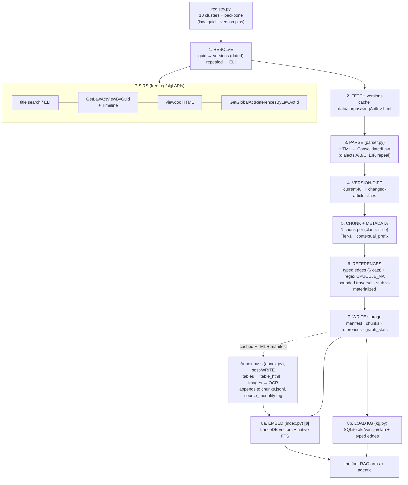

# ingestion_pipeline.md — PIS → structured knowledge base

> One of the **six design docs** ([data_sources](./data_sources.md) · ingestion_pipeline · [knowledge_base](./knowledge_base.md) · [rag_arms](./rag_arms.md) · [ui](./ui.md) · [benchmark](./benchmark.md)). Self-contained: the **pipeline design, the transformations, indexing, periodic refresh, and every design decision with its rejected alternatives**. Inputs come from [data_sources](./data_sources.md); the artifacts it produces are specified in [knowledge_base](./knowledge_base.md).

> **Design credit:** the ingestion pipeline described here was co-designed with **[Saša Mirković](https://github.com/SasaMirkovic)**.

## 1. What the pipeline does, in one paragraph

It turns a chosen set of Serbian laws (10 thematic clusters + a shared backbone, defined in `src/lexsr/registry.py`) into three queryable stores: a **vector + full-text index** (LanceDB), a **typed temporal knowledge graph** (stdlib SQLite), and a set of **flat artifacts** in `data/corpus/` (`manifest.json`, `chunks.jsonl`, `references.jsonl`, `graph_stats.json`, `failures.json`) that are the local source of record. It is **triggerable** (whole corpus, one cluster, or named laws) and **incremental** (merges into existing storage). **Step 1 is a live, rate-limited crawl of the source, not a re-parse of a local snapshot** — reference resolution and bylaw materialization both fetch, so a build reflects the state of the source on the day it runs and two builds weeks apart yield different corpora (§9). The KG build is free and deterministic; embedding costs money and is a separate step.

CLI (`src/lexsr/ingest.py`):
```
python -m lexsr.ingest all                 # whole corpus
python -m lexsr.ingest 1                    # one cluster
python -m lexsr.ingest zakon-o-radu,pio     # specific laws (incremental)
python -m lexsr.ingest all --fresh          # clean-slate (ignore existing storage)
python -m lexsr.ingest all --embed --kg     # + re-embed ($) + rebuild KG
python -m lexsr.ingest all --no-references  # seeds/backbone only, no L2/L3 traversal
python -m lexsr.index    # (re)embed chunks.jsonl → LanceDB   [$ cost]
python -m lexsr.kg       # (re)build the KG (SQLite) from chunks+manifest+references [free]
python -m lexsr.annex          # HTML-table annex chunks (deterministic, free)
python -m lexsr.annex --ocr    # + image-annex OCR (gemini vision)       [$ cost]
```

## 2. The stage diagram



## 3. Stage-by-stage

1. **Resolve** (`pis.py`): for each registry spec, `law_guid → get_law_view` (current + previous versions) and `get_timeline` (per-version dates). Repealed laws (e.g. ZZPL 2008) have no registry entry → resolved via their **ELI path** (`resolve_eli → lawAdActGuid → GetLawActViewByLawAdActGuid`). Pins are re-resolved here, never trusted as permanent.
2. **Fetch versions** (`pis.fetch_consolidated_html`): each version's HTML, cached to `data/corpus/<regActId>.html`. Politeness throttle applies (3 s). The cache lets re-parsing be offline/free; we re-fetch only on refresh.
3. **Parse** (`parser.py`): one state machine, three dialects (A/B/C — see [data_sources §5](./data_sources.md)). Produces `ConsolidatedLaw { title, gazette_chain[], clanovi[], valid_to?, repealed_by? }`. Extracts **entry into force** from the law's „…ступа на снагу…" clause (осмог дана → +8, наредног дана → +1, named date, else constitutional +8 default), keeping *početak primene* (vacatio legis) separate. Repeal notes ("Брисан је…", "Престао је да важи…") detected by **text, not class**.
4. **Version-diff**: current version → all članci; older versions → only članci whose text **differs** from the next-newer version, emitted as `…/clan-N@<regactid>` slices carrying `[valid_from, valid_to]`. (Fork B — ADR-8.)
5. **Chunk + metadata** (`to_chunks` + `metadata.py`): one `Chunk` per (član × slice), stamped with Tier-1 metadata (temporal triple, structural breadcrumb, type tags) and a light `contextual_prefix` (prepending document-level context to a chunk before embedding measurably cuts retrieval-failure rate — Anthropic 2024, *Contextual Retrieval*). CC decisions are chunked at **holding level** (one izreka chunk). See [knowledge_base](./knowledge_base.md) for the full chunk schema.
   - **Annex pass (`lexsr.annex` — a separate CLI, run post-WRITE over the cached HTML + manifest, appending to `chunks.jsonl`):** HTML `<table>` annexes → markdown chunks (deterministic), and image annexes (`Attachment/slike/…`) → gemini-3.6-flash OCR → markdown chunks, both flagged `source_modality` with the source URL as provenance. Additive (separate from the prose parser) — see §6.
6. **References** (`ingest._references` + `kg.py`): pull the 6 typed categories, apply the **bounded-traversal policy** (§5), partition targets into **materialized** (fetched + chunked) vs **stub** (edge + metadata only). Regex `UPUCUJE_NA` cross-references are extracted from stav text and closed against in-corpus articles.
7. **Write storage**: `manifest.json` (every act), `chunks.jsonl` (materialized only), `references.jsonl` (all edges incl. stubs), `graph_stats.json` (ingest *merges* only the closure keys — `lexsr.kg` owns the density keys), `failures.json`. Merge rules: **a materialized record always beats a stub** for the same act — law A may know act X only as a tangential stub while law B materialized it, and a stub-marked act with embedded chunks would be structurally unreachable (`materialized = 1` filters); **a spec whose re-ingest fails is restored wholesale** (manifest + chunks + edges — a transient network error must not delete a law); annex chunks of re-ingested laws are dropped by design and a warning tells the operator to re-run `lexsr.annex`.
8. **Embed + KG**: `index.py` embeds each chunk into LanceDB (gemini-embedding-2) and builds the Lance-native FTS index — a **hybrid** of dense retrieval (Karpukhin et al. 2020, EMNLP — DPR) and lexical BM25 (Robertson & Zaragoza 2009), the two fused at query time by the advanced/graph/agentic arms via reciprocal-rank fusion (Cormack et al. 2009, SIGIR); the naive baseline is deliberately dense-only (arm details in [rag_arms](./rag_arms.md)). The retrieval-augmented serving pattern itself follows Lewis et al. 2020 (NeurIPS — RAG). `kg.py` rebuilds the KG — typed node/edge tables in stdlib SQLite — from the flat artifacts (a full `executemany` rebuild takes ~2 s and ends in a count gate against the stats counters).

## 4. The corpus at a glance

The default build (`ingest all` → `annex` tables → `annex --ocr` → `index` → `kg`) materializes the 10-cluster + backbone scope. Representative current figures (live numbers in `graph_stats.json` / [knowledge_base](./knowledge_base.md) §9):

- **39 registry acts** (4 hub + 2 foundational + 33 seeds across clusters 1–10).
- **~536 materialized acts** (the 39 seeds/backbone + ~476 materialized bylaws + 21 CC holdings) + **~1,707 stubs** — the bylaw layer is uncapped (ADR-9). Of the ~1,021 reachable bylaw targets, **~546 stay stubs although they fetch fine as HTML**: they are rešenja/odluke/indeksi structured by тачка, not „Члан N.", so `_materialize_reference` finds no članci and discards them — a parser/ingest limitation, not a PIS coverage limit (§9).
- **~25.7k chunks**: članak/version-slice prose + ~910 HTML-table annexes + ~167 image-OCR annexes (§6), all embedded into LanceDB. Embedding is the only paid step (incremental); parsing + KG are free.
- **KG store:** ~2,243 `akt`, ~177 `verzija`, ~25.7k `clan`; `UPUCUJE_NA` + `NEXT` + **term-aware** `DEFINED_IN` (an article links to its glossary only when it uses a defined term — the honest expansion reach, [rag_arms §3](./rag_arms.md)) + typed reference edges (per-type counts + density in [knowledge_base §9](./knowledge_base.md)).
- **Cross-law `UPUCUJE_NA` ~264** — the uncapped bylaw layer adds real topical connectivity, but the numbered cross-reference web stays intrinsically sparse (the GraphRAG negative-result finding — [benchmark §6](./benchmark.md)).
- **Cache reuse (ADR-11):** fetches are keyed by `<regactid>.html`; a reconsolidation mints a new id → cache miss → fresh fetch, so reuse is always correct (`--no-cache` forces refetch).

## 5. The bounded-traversal policy (the cost/quality knob)

The graph is **complete** (every reference becomes a node) but fetching is **bounded** (cost ∝ what we materialize). One typed hop, then close the induced subgraph and stop — **no depth-2 fetch**.

| Category | Policy |
|---|---|
| amendments / versions | from the gazette chain + timeline |
| `OCENA_USTAVNOSTI` (CC decisions) | **fetch all** (tiny, validity-critical), holding-level |
| `PRAVNI_OSNOV_ZA` (bylaws) | **attempt every reachable target**, uncapped (ADR-9): **475** of ~1,021 acts materialize (476 edges reach them); the remaining **~546** carry no član structure and stay stubs (§9). `bylaw_cap` stays as an optional knob (`None` = uncapped, the default). |
| `POVEZAN_SA`, `UTICAO_NA` (tangential) | edge-only (stub unless already in-corpus) — never injected into flat retrieval |
| hubs (Ustav/ZUP/ZOO/prekršaji) | materialized for closure; we don't fan out *from* them; their edges are `down_weight`-flagged |

**"No further" still closes edges among the now-larger materialized set for free** (the regex `UPUCUJE_NA` runs over bylaw text too and links to in-corpus articles) — we just don't call `get_references` on the bylaws (no depth-2).

## 6. Annex handling — tables + image OCR (`lexsr.annex`)

**There are no standalone PDFs in the reference graph** — only **HTML `<table>` annexes** and **embedded image annexes** (obrasci/tabele/dijagrami served as PNG/JPG via `Attachment/slike/…`). Both are handled as **additive chunks** by `lexsr.annex` (never touching the contract-locked prose parser), flagged `source_modality` ∈ {`table_html`, `ocr`}:

- **Tables (deterministic, free):** each `<table>` → a markdown table chunk (~910 across ~99 acts).
- **Image OCR:** `` annexes are fetched and transcribed by **gemini-3.6-flash** (multimodal — the `images=` param on `kl_core.providers.gemini.GeminiLLM.generate`), prompted to emit Cyrillic markdown so table structure survives. ~167 chunks; **canonical provenance = the image URL** (OCR is not verbatim-authoritative — invariant 1).

**Robustness:** the OCR pass is **resumable** (skips acts that already have OCR chunks), **checkpointed** (writes after every act, so a crash never loses in-flight work), **fail-fast** (20 s fetch / 240 s vision timeouts (16384-token OCR output cap); per-image `try/except`), and **per-act image-capped** (`_MAX_IMAGES_PER_ACT=20`, so one pathological act — e.g. a several-hundred-image org chart — can't dominate cost/time; the cap is logged).

**Risks:** OCR error on Cyrillic numerics in tariff tables → mitigated by the `ocr` flag + image-URL provenance (never silently authoritative; arms can exclude `source_modality=ocr` from authoritative citations). Tesseract (srp) was considered and rejected: free but weaker on Cyrillic forms/tables, and we already pay for Gemini. For a rare true PDF (none in the reference graph today): `pymupdf` text layer → vision-OCR fallback.

## 7. Periodic knowledge-base refresh

Statutes amend several times a year, so the KB must re-sync with PIS. The refresh **design** and its **current mechanism**:

- **Change detection:** a law has changed iff its current registry `regactid` ≠ the manifest pin. Pins are re-resolved via `law_guid` at every ingest (stage 1), so re-ingesting a changed law naturally re-fetches the new consolidation.
- **Incremental re-embed:** `index.update_laws(slugs)` deletes + re-embeds **only the given laws' rows** (cost ∝ change, not corpus); the KG is then rebuilt fully from the flat artifacts (`lexsr.kg`, cheap). A routine amendment therefore costs one law's embeddings, not a full re-index.
- **How it runs today:** manually, on a dev machine with the repo's `data/` checkout, the API keys, and LFS write access — re-ingest the changed laws, then `index.update_laws` + `lexsr.kg`, and commit the regenerated artifacts. Orthogonal to the multi-version build (refresh tracks the *current* consolidation; version history is built once).
- **Not automated:** there is no scheduled dry-run / check-and-notify / apply CLI, so nothing detects a PIS reconsolidation on its own — the KB is only as current as the last manual run (§9). The incremental primitive such a wrapper would call (`index.update_laws`) does exist.

## 8. Design decisions (numbered, with rejected alternatives)

| # | Decision | Why | Rejected alternative (why not) |
|---|---|---|---|
| ADR-1 | **Scrape the `viewdoc`/API, not the site.** | Server-rendered, semantically-classed HTML; no headless browser, no PDF diffing. Article-structure-aware parsing of the served HTML is what makes article-level chunking and the typed reference graph possible (structure-aware parsing improves legal retrieval — Reuter et al. 2025, NLLP@EMNLP; Fadillah et al. 2026, *Data Technologies & Applications*). | Headless-browser the JS shell — slow, brittle, unnecessary. |
| ADR-2 | **ELI URIs are the provenance identifiers.** | PIS exposes them natively → canonical, stable, free; ELI is the EU standard for legislation identification, FRBR-based (work/expression/manifestation), endorsed by Council conclusions of Oct 2012 and 6 Nov 2017 (Council of the EU 2012, 2017, OJ; FRBR — IFLA 1998). | Invent our own ids — reinvents a standard, breaks interop. |
| ADR-3 | **One parser, three dialects, locked by real fixtures.** | A/B/C share 90% of logic; a state machine + class tables + shape heuristics covers all. The article/structure boundaries it recovers mirror the Akoma Ntoso legislative document model (OASIS LegalDocML 2018). | Per-dialect parser classes — premature until a 4th dialect forces it. |
| ADR-4 | **Chunk granularity = član × version-slice.** | The article is the provenance + citation unit; stav is too fine, whole-law defeats retrieval — retrieval granularity materially affects accuracy (Chen et al. 2024, EMNLP; cf. Jiang et al. 2024 LongRAG for larger units), and article/structure-aligned chunking beats sequential splitting for law (Fadillah et al. 2026). (See [knowledge_base](./knowledge_base.md).) | stav-level (context fragmentation) / whole-law (top-k uselessness). |
| ADR-5 | **10 deep clusters + shared backbone, not 30 shallow laws.** | Depth over breadth: closed legal domains, denser reference graph, a fair test for the graph arm; matches real citizen questions. | 30 shallow laws — thinner pool, sparser graph, less realistic. |
| ADR-6 | **Stub vs materialized nodes.** | Graph stays *complete* (every edge has a target) while fetch stays *bounded*; stubs fail safe ("outside the KB") honoring the provenance invariant. | No stubs (missing edges) / materialize everything reachable (cost + depth-2 explosion). |
| ADR-7 | **Typed `Akt{vrsta}` + `Verzija` version slices.** | One uniform reference target for every edge; the version layer is the structural fix for version skew. | Flat `Zakon`-only (non-uniform targets, no temporal slicing). |
| ADR-8 | **Current-full + changed-article slices (Fork B), not full history.** | Embedding N near-identical copies of an unchanged članak crowds top-k with duplicates; fetch cost is identical either way. Zakon o radu kept at full history as the temporal showcase. | Full history (index bloat, duplicate crowding) / current-only (misses skewed cross-ref targets). |
| ADR-9 | **No bylaw cap; materialize all reachable bylaws.** | A missing bylaw is unrecoverable at inference — a cap of any size directly bounds answer correctness for delegated-norm questions. All bylaw stubs are HTML on `reg` (no OCR needed). Crowding is solved at *retrieval* time (diversity + hierarchy — see [rag_arms](./rag_arms.md)), not by withholding documents. | Cap the bylaw layer (correctness ceiling) / principled top-N selection (still drops answer-bearing bylaws). |
| ADR-10 | **Embedding/refresh are separate, idempotent steps.** | Parsing + KG are free and offline; only embedding costs money, so re-embed is opt-in and incremental. | One monolithic build (re-pays for embeddings on every reparse). |
| ADR-11 | **regactid-keyed HTML cache reuse.** | Re-ingests needn't re-download already-fetched versions; a new consolidation = new regactid = automatic cache miss, so reuse is always correct. | No cache (re-downloads the whole corpus every run — slow + impolite to PIS). |
| ADR-12 | **Annexes are additive chunks via `lexsr.annex`, not a parser change.** | Keeps the contract-locked prose parser untouched while making tables (deterministic) + image OCR (gemini-3.6-flash) retrievable; resumable/checkpointed/capped. | Rewrite the parser to weave tables/images inline (risks the locked fixtures). |

## References

Each citation below was verified against a primary source (arXiv/ACL Anthology/publisher/standards body).

- **Lewis, P., Perez, E., Piktus, A., et al. (2020).** Retrieval-Augmented Generation for Knowledge-Intensive NLP Tasks. *Advances in Neural Information Processing Systems (NeurIPS) 33*, 9459–9474. https://arxiv.org/abs/2005.11401 — the RAG serving pattern (parametric + non-parametric memory).
- **Karpukhin, V., Oğuz, B., Min, S., et al. (2020).** Dense Passage Retrieval for Open-Domain Question Answering. *EMNLP 2020*, 6769–6781. https://aclanthology.org/2020.emnlp-main.550/ — dual-encoder dense retrieval (the dense half of the index).
- **Robertson, S., & Zaragoza, H. (2009).** The Probabilistic Relevance Framework: BM25 and Beyond. *Foundations and Trends in Information Retrieval, 3*(4), 333–389. https://www.nowpublishers.com/article/Details/INR-019 — BM25 (the lexical/FTS half).
- **Cormack, G. V., Clarke, C. L. A., & Büttcher, S. (2009).** Reciprocal Rank Fusion Outperforms Condorcet and Individual Rank Learning Methods. *SIGIR 2009*, 758–759. https://doi.org/10.1145/1571941.1572114 — RRF (dense + lexical fusion).
- **Chen, T., Wang, H., Chen, S., et al. (2024).** Dense X Retrieval: What Retrieval Granularity Should We Use? *EMNLP 2024*. https://aclanthology.org/2024.emnlp-main.845/ — retrieval-granularity matters; motivates a deliberate chunk unit.
- **Jiang, Z., Ma, X., & Chen, W. (2024).** LongRAG: Enhancing Retrieval-Augmented Generation with Long-context LLMs. arXiv:2406.15319. https://arxiv.org/abs/2406.15319 — larger, semantically-coherent retrieval units (the article as a coherent unit).
- **Fadillah, A., Athahirah, N., & Lai, K.-T. (2026).** LawRAG: Indonesian legal document retrieval-augmented generation with specialized chunking and reranking strategies. *Data Technologies and Applications, 60*(2), 330–347. https://www.emerald.com/dta/article/60/2/330 — title/article/paragraph-aware chunking beats sequential splitting for statutes.
- **Reuter, M., Lingenberg, T., Liepiņa, R., et al. (2025).** Towards Reliable Retrieval in RAG Systems for Large Legal Datasets. *7th Natural Legal Language Processing Workshop (NLLP @ EMNLP 2025)*; arXiv:2510.06999. https://arxiv.org/abs/2510.06999 — document-level retrieval mismatch and structure-aware mitigation in legal RAG.
- **Anthropic (2024).** Introducing Contextual Retrieval. https://www.anthropic.com/news/contextual-retrieval — prepending chunk-level context before embedding/BM25 reduces retrieval-failure rate (motivates `contextual_prefix`).
- **OASIS LegalDocML TC (2018).** Akoma Ntoso Version 1.0 (OASIS Standard). https://docs.oasis-open.org/legaldocml/akn-core/v1.0/ — the legislative document structure model the dialect parser recovers.
- **Council of the European Union (2012).** Council conclusions inviting the introduction of the European Legislation Identifier. OJ C 325, 26.10.2012 (CELEX 52012XG1026(01)). And **(2017)** Council conclusions of 6 November 2017 on the ELI. OJ C 441, 22.12.2017 (CELEX 52017XG1222(02)). https://eur-lex.europa.eu/eli-register/about.html — ELI standard for provenance URIs.
- **IFLA Study Group (1998).** Functional Requirements for Bibliographic Records (FRBR): Final Report. https://www.ifla.org/publications/functional-requirements-for-bibliographic-records/ — the work/expression/manifestation/item model underlying ELI's version layer.

## 9. Open questions & consequences

- **In-corpus membership is keyed on the current `regactid`** (the references payload carries no guid). A reconsolidation can drift a reference target out of "in-corpus" until a refresh re-pins it; if this bites in practice, resolve targets via `GetEliInfoBy*` to a stable id.
- **The refresh is manual, not scheduled (§7).** The incremental re-embed primitive (`index.update_laws`) exists, but nothing wraps it in change detection, so a maintainer must notice a PIS reconsolidation and run the re-ingest + `index.update_laws` + `lexsr.kg` by hand. Consequence: **the corpus can silently go stale**, and a stale corpus is an invariant-2 hazard in exactly the way this project's temporal claims are about.
- **The OCR per-act image cap (20) can skip overflow images.** Exactly one act in the current corpus trips the cap (a several-hundred-image systematization annex of low QA value) — but a *capped* act could in principle drop an answer-bearing image; raise the cap per-act if a real tariff annex ever exceeds 20.
- **OCR is non-verbatim.** A Cyrillic-numeric transcription error in a tariff table could mislead; mitigated by the `source_modality=ocr` flag + image-URL provenance (arms can exclude OCR chunks from authoritative citations), never silently authoritative (invariant 1).
- **~Half the bylaw layer does not survive chunking.** ~546 of ~1,021 `PRAVNI_OSNOV_ZA` targets fetch as HTML but carry no „Члан N." structure (rešenja/odluke/indeksi are тачка-structured), so `_materialize_reference` returns `None` and they degrade to stubs — and the manifest records **no reason**, so a policy stub and a parse-failure stub are indistinguishable in the shipped artifact. Fix candidates: a tačka-level fallback chunker, or at minimum a `stub_reason` field.
- **The cross-reference web is intrinsically sparse** even after uncapping bylaws — a corpus property, not a pipeline gap; it is the substance of the GraphRAG negative result ([benchmark §6](./benchmark.md)), not a defect to engineer away.
