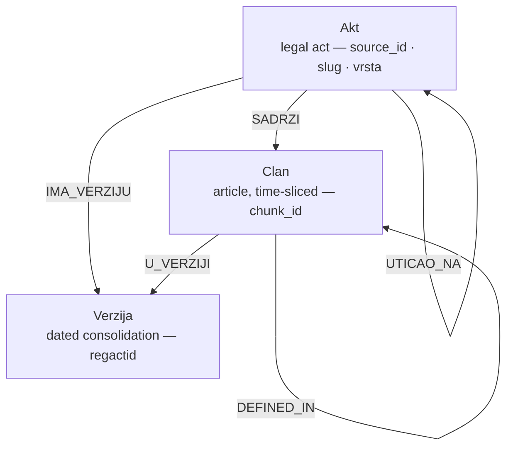

# knowledge_base.md — the data model, stores, and boundaries

> One of the **six design docs** ([data_sources](./data_sources.md) · [ingestion_pipeline](./ingestion_pipeline.md) · knowledge_base · [rag_arms](./rag_arms.md) · [ui](./ui.md) · [benchmark](./benchmark.md)). Self-contained: the **data structures, their specifications, the temporal model, the stores, and the downstream consequences** of each design choice. The KB is the **single shared foundation every RAG arm retrieves over** — its quality is the ceiling on all of them.

> **Design credit:** the knowledge base described here was co-designed with **[Saša Mirković](https://github.com/SasaMirkovic)**.

## 1. The data model: `Akt → Verzija → Clan`

The corpus is a typed temporal graph of three node kinds. The three-level *act → version → article* decomposition mirrors the structural model that the legal-document standards converge on — the Akoma Ntoso hierarchy of act/body/article and its explicit notion of dated *consolidations* (Palmirani & Vitali, 2011, *Legislative XML for the Semantic Web*; OASIS Akoma Ntoso v1.0, 2018) — without committing to the full XML vocabulary.

### `Akt` — a legal act (the uniform reference target)
One node label with a discriminator, so *every* reference edge points at a uniform target.
- `source_id` (PK, ELI-derived for seeds — the European Legislation Identifier's HTTP-URI template keyed on jurisdiction/type/year/number (Council of the EU, 2012, OJ C 325/02; reaffirmed 2017, OJ C 441/05) — `ref/<regActId>` for periphery), `slug`, `title`, `registry_title`
- `vrsta` ∈ {`zakon`, `ustav`, `podzakonski_akt`, `odluka_us`, `akt`} — the fine-grained PIS categories (pravilnik/uredba/odluka/autenticno_tumacenje) collapse to `podzakonski_akt` in the current corpus
- `role` ∈ {`seed`, `hub`, `foundational`, `referenced`, `stub`}
- `cluster` (`"1"`..`"10"` | `backbone` | `referenced`)
- `materialized: bool`, `in_corpus_depth: 0|1`, `down_weight: bool`
- law-level temporal: `valid_from`, `valid_to`, `applies_from`, `repealed_by`, `eli`

### `Verzija` — one dated consolidation
- `regactid` (PK), `akt_source`, `applies_from` (PIS `versionApplicationDate`)
- An `Akt` has one `IMA_VERZIJU` edge per consolidation; a `Clan` slice hangs off the version it lived in (`U_VERZIJI`).

### `Clan` — an article, time-sliced
- `chunk_id` (PK — the identity spine, §4), `source_id`, `law_slug`, `number`, `fragment`
- `text`, `structural_path`, `article_heading`, `chapter`, `status`
- temporal: `valid_from`, `valid_to`, `applies_from`, `published`, `repealed`
- type tags: `is_definitions`, `is_penalty`; `version`, `is_version_slice`, `cc_outcome`

## 2. Stub vs materialized (the completeness/cost split)

- Every **referenced** act becomes a **node** → the graph is **complete** (no dangling edges).
- Only acts we **fetch** are **materialized**: `materialized:true`, chunks in the vector index, retrievable.
- Everything else is a **stub**: id + title + vrsta + edges only — reachable as a graph seed, **not retrievable**. A stub fails safe: the assistant says *"outside the KB"* rather than hallucinating (invariant 1).

Representative current scale: **~536 materialized** (39 seeds/backbone + ~476 bylaws + 21 CC holdings) + **~1,707 stubs**: ~1,161 tangential `POVEZAN_SA`/`UTICAO_NA` targets (edge-only, never fetched) plus **~546 cited bylaws that fetch as HTML but carry no „Члан N." structure** (rešenja/odluke/indeksi), so they don't survive chunking — a pipeline coverage limit larger than the materialized bylaw layer itself ([ingestion_pipeline §9](./ingestion_pipeline.md)). **~25.7k chunks** = članak/version-slice prose + ~910 table annexes + ~167 image-OCR annexes.

## 3. Chunk granularity & versioning

- **Granularity = član** (the provenance + citation unit; stav is kept in metadata; whole-law would defeat retrieval). — ADR-4. The article is the established retrieval and relevance unit in statutory-retrieval research — the task of mapping a question to the relevant *statutory articles* (Louis & Spanakis, 2022, ACL — the BSARD dataset of 22.6k Belgian law articles; Louis et al., 2023, EACL).
- **One chunk per (član, version-slice).** Current version → all članci (plain `…/clan-N`). Older versions → only članci whose text changed, as `…/clan-N@<regactid>` slices carrying `[valid_from, valid_to]`. — Fork B / ADR-8.
- **Acts without article structure** (CC decisions: izreka + obrazloženje) → **one holding-level chunk** (`…/holding`), `vrsta=odluka_us`, consumed through the `OCENA_USTAVNOSTI` edge for validity — no full odluka-US parser needed. — Fork A.
- **Full-history promotion policy:** a law is promoted from Fork B to full history when a cited target version would otherwise be missing (key cross-refs, e.g. `doprinosi → PIO`, are verified to resolve). Zakon o radu is the one full-history law (temporal showcase).

## 4. The identity spine: `chunk_id`

`chunk_id` (ELI-derived, version-aware) is the **single join key** across all three stores: `chunks.jsonl` ↔ the LanceDB row ↔ the KG `clan` row. Forms: `<source_id>/clan-<number>[@<regactid>]` (articles + dated slices; `<number>` may carry a Cyrillic letter suffix — `clan-179а`), `<source_id>/holding` (CC decisions), and `<source_id>/prilog-<modality>-<n>` (annex rows: `table_html` / `ocr`). Without it `get_clan` / `expand_references` (the agentic arm) break — so it is invariant across the whole pipeline. Deriving a stable, dereferenceable identifier from the ELI URI (rather than an opaque surrogate key) follows the ELI design rationale of using the persistent legislation identifier as the linking spine across systems (Council of the EU, 2012, OJ C 325/02).

## 5. The metadata model — three buckets (the corpus-intrinsic vs treatment split)

Metadata is split by *who is allowed to use it*, so the arms stay a controlled comparison.

**Tier-1 — corpus-intrinsic provenance (ALL arms, ALL stores).** It is provenance, not a retrieval trick, so it's shared (carrying law/article/version/ELI on every retrievable unit is the operational form of invariant 1 — attributable, source-grounded generation, the central concern of retrieval-augmented generation (Lewis et al., 2020, NeurIPS)):
- *Identity:* chunk_id, source_id, law_slug, vrsta, number, ELI url.
- *Temporal triple:* `published` (gazette date), `valid_from` (entry into force), `applies_from` (vacatio legis), `valid_to`, `status`, gazette chain.
- *Structural neighbourhood:* cluster, `structural_path` (Глава › пододељак), `article_heading`, `prev_clan`/`next_clan`, `ordinal`, `stav_count`.
- *Type tags (deterministic):* `is_definitions`, `is_penalty`, `delegates_to_bylaw`.
- *Corpus role:* role, in_corpus_depth, materialized.

**Tier-2 — relational/contextual (the treatment layer):**
- relational: **not denormalized onto chunks** — outgoing/incoming/cross-law references are queried **live from the KG** at retrieval time by the arms that opt in (graph, agentic), which is what keeps them arm-scoped.
- retrieval aids: `contextual_prefix` (an *article-first* line — fragment · heading breadcrumb · law title · in-force date, deliberately discriminative-first because constant law-title prefixes dilute embeddings; version slices, CC holdings, and annexes carry their own variants — **wired into the embedding input unconditionally**, and therefore corpus-wide, not arm-scoped; no bare-text ablation exists, so its uplift is unmeasured — §11).

### How the buckets map to retrieval modalities
The three modalities stay clean, each tapping the right thing — the dense-vector + sparse-lexical pairing is the now-standard hybrid retrieval stack, where a learned dual-encoder dense retriever and a BM25 keyword index are complementary (dense wins on semantics, BM25 on rare/exact terms) (Karpukhin et al., 2020, EMNLP — DPR; Robertson & Zaragoza, 2009, *FnTIR* — BM25):
1. **Structured columns (filters):** all Tier-1 — filterable + displayed + KG-feeding. No downside, always on.
2. **Vector embedding input:** `contextual_prefix` + članak text. Relational metadata is **never embedded** (it's a graph fact, not a semantic one).
3. **FTS / BM25 input:** **bare** article text only (keyword-faithful; repeating the law title or heading would skew TF-IDF; transliteration applies to the query side only).

## 6. The temporal model (the novelty axis)

Time-stamping each article slice with a `[valid_from, valid_to]` interval and resolving queries `as_of` a date is the **valid-time** dimension of temporal databases — the time a fact is true in the modelled world, as opposed to transaction time (when it was recorded) (Snodgrass, 1987, *ACM TODS* — TQuel, the early formalisation of valid time in a query language; Jensen & Snodgrass, 1999, *IEEE TKDE* — the valid-/transaction-time taxonomy; standardised as application-/system-time periods in SQL:2011). The legal specialisation — separating **entry into force** from **start of application** (*vacatio legis*) and from **publication** — corresponds to the explicit temporal/event model that legal-document standards carry for amendment and consolidation (LegalRuleML's first-class treatment of *legal sources, time, and defeasibility* — Athan et al., 2013, ICAIL; Akoma Ntoso legislative-change/version modelling — Palmirani et al., 2011, in *Legislative XML for the Semantic Web*). The KB tracks valid time only; an audit/transaction-time axis is deliberately out of scope (a possible bitemporal extension — §11).

Three distinct dates, never conflated:
- **`published`** — gazette issue date (when enacted/amended).
- **`valid_from` = entry into force (*stupanje na snagu*)** — computed from the law's „ступа на снагу" clause: осмог дана → publication +8, наредног дана → +1, даном објављивања → +0, a named absolute date → that date, else the **constitutional +8-day default** (Ustav čl. 196). Per article: an unchanged člano inherits the law's EIF; an amended one takes the EIF of the gazette issue that last changed it. **This is what `in_force_on` / the `as_of` filter keys on.**
- **`applies_from` = početak primene (vacatio legis)** — carried separately (e.g. Zakon o digitalnoj imovini enters force +8 days but applies +6 months); surfaced when it differs from `valid_from`.
- **`valid_to`** — the repealing gazette's publication date (brisan articles); whole-law-repealed statutes (ZZPL 2008) inherit a law-level `valid_to` from the dialect-C publisher's note.

**Constitutional invalidation is a first-class temporal death:** a struck `OCENA_USTAVNOSTI` decision sets the target článo's `status`="престао по одлуци УС" + `valid_to`=the decision date + `repealed`=true. `parser.cc_struck_targets` extracts the (law, article) from the izreka — **resolution-gated** (mutates only when the target resolves to an in-corpus article — no false invalidation, invariant 2) — and **distinguishes whole-article strikes from partial ones**: only a whole-article strike repeals; a *partial* strike (став/тачка struck) leaves the article in force and records a `cc_note` (so „члан 179 став 3 тачка 5" never flattens into article numbers that would falsely repeal sibling provisions or the whole article). Invalidation is computed **at ingest** (`kg.apply_cc_invalidation` over the chunk records) and written to `chunks.jsonl`, so **both LanceDB and the KG inherit it** — the flat arms (naive/advanced/stuffing) see struck articles as repealed too, not only the structural arm.

## 7. The edge taxonomy

A *typed* edge taxonomy (rather than a single untyped "cites" relation) over statute text is the legal-knowledge-graph approach to representing legislation: cross-references, hierarchical/structural links, and citation/treatment relations are modelled as distinct, named edges so that traversal can be relation-aware (Filtz et al., 2021, *Artificial Intelligence and Law* — a methodology for a legal KG over legislation and case law, linked via ELI/ECLI; Louis et al., 2023, EACL — exploiting the hierarchical/cross-reference structure of statutes for retrieval). The edge *labels* themselves are derived from the corpus's own authoritative relations (the 6 PIS categories) rather than an external upper ontology; LKIF-Core and LegalRuleML (Hoekstra et al., 2009; Athan et al., 2013) are the reference points for *what kinds* of legal relations exist, but the schema here is intentionally lighter (no deontic/defeasible reasoning layer — §11).

**Intra-law (structural, from regex over stav text + parser):**
| Edge | Meaning |
|---|---|
| `SADRZI` | act → its articles |
| `UPUCUJE_NA {mention}` | article → article cross-reference |
| `NEXT` | sequential article (document order) |
| `DEFINED_IN` | article → its law's definitions article |

**Inter-act (authoritative L2, from the 6 PIS categories):**
| Edge | From → To | Down-weight policy |
|---|---|---|
| `PRAVNI_OSNOV_ZA` | law → bylaw (the dense layer) | column not carried — never down-weighted (informative) |
| `OCENA_USTAVNOSTI` | law → CC decision against it (FROM=law, TO=odluka_us; the outcome lives on the holding's `clan.cc_outcome`, not the edge) | column not carried — never down-weighted (high-signal, validity) |
| `USTAVNI_OSNOV` | law → Ustav (enactment basis) | act-level; never traversed by the arm |
| `POVEZAN_SA` | law ↔ act (related/connected) | n/a — hub-origin rows never enter; the column is a residual guard (all 0 today) |
| `UTICAO_NA` | act → law (affected-by) | n/a — same residual guard |

Hub handling is role-based: the four hub acts (`ustav-rs`/`zup`/`zoo`/`prekrsaji`, `Role.HUB` in `registry.py`) are **excluded from the act-level reference fan-out at ingest**, so no hub-origin `POVEZAN_SA`/`USTAVNI_OSNOV` rows exist (0 in the store) — the graph equivalent of stop-words, keeping the GraphRAG arm tested on genuine topical links rather than on "everything cites the Constitution/ZOO". Hub articles' **in-text `UPUCUJE_NA`** edges (~165) do enter the graph and are traversed by the 2-hop layer. The `down_weight` column (carried only on the `POVEZAN_SA`/`UTICAO_NA`/`USTAVNI_OSNOV` tables) is stamped from the source act's role and serves as a residual guard on the related-law hop (`down_weight = 0` filter — all rows are 0 today, since hub-origin act relations never materialize); `USTAVNI_OSNOV` is act-level and never traversed by the arm ([rag_arms §3](./rag_arms.md)).

## 8. The stores

The dual-store shape — a dense-vector index for semantic retrieval alongside a typed property graph for relation traversal — is the substrate that graph-based RAG assumes (Edge et al., 2024, Microsoft, arXiv:2404.16130 — GraphRAG). The specific embedded *products* (LanceDB; stdlib SQLite for the graph) are an engineering choice, not a literature claim; what is grounded is the *paradigm* (dense dual-encoder retrieval — Karpukhin et al., 2020, EMNLP — over a property/knowledge graph), not the vendor. Materializing a property graph as relational tables is itself standardized practice (SQL:2023 **SQL/PGQ**, ISO/IEC 9075-16 — property-graph queries over relational tables).

**LanceDB (`data/index/`, embedded, built locally)** — one `chunks` table, one row per chunk: the gemini-embedding-2 vector (`RETRIEVAL_DOCUMENT`), the bare `text` (for Lance-native FTS / BM25 — the native engine of the pinned `lancedb ~=0.33`, default English analyzer, effectively unstemmed for Serbian Cyrillic), and the Tier-1 columns the arms filter on: `law_slug`, `source_id`, `valid_from`, `valid_to`, `applies_from`, `published`, `repealed`, `status`, `structural_path`, `is_definitions`, `is_penalty`, `delegates_to_bylaw`, and the L0–L3 facets `vrsta`, `role`, `in_corpus_depth`, `is_version_slice`, `cc_outcome`, `cluster`, `source_modality` (`text` | `table_html` | `ocr`), `is_annex`, plus a full `metadata_json` blob. FTS index on `text`. **Annex chunks** (tables/OCR — [ingestion_pipeline §6](./ingestion_pipeline.md)) are retrievable rows flagged `source_modality`, so an arm *could* exclude the non-verbatim `ocr` ones — **no arm does today** (§11).

**Typed KG in stdlib SQLite (`data/kg.sqlite`, embedded, built locally)** — one `STRICT` table per node type (`akt`/`verzija`/`clan`) and per edge type (the typed edges above), with endpoint `FOREIGN KEY`s, so the typed schema is enforced by the store rather than by convention. Stub `akt` rows carry metadata only. `clan.seq` (document order) is the deterministic `ORDER BY` key for every truncated *article* expansion query; the act-level hops (bylaw, related-law) order by edge-insertion rowid — deterministic too, but not relevance-ranked ([rag_arms §3](./rag_arms.md)). Which rows survive a `LIMIT` never depends on engine row order. Built fresh from the flat artifacts each time (`executemany` bulk load, ~2 s), and gated: after the build, store-side `SELECT count(*)` per table must equal the Python-side counters that produce `graph_stats.json` — a one-command auditability check (`sqlite3 data/kg.sqlite` opens the shipped graph anywhere, no library needed). Serve-time access is `lexsr.kg.KGStore` — thread-local read-only connections returning plain dict rows (the FastAPI threadpool and background bench batches each get their own connection).

**Flat artifacts (`data/corpus/`)** — the local source of record produced by a build: `manifest.json` (every act), `graph_stats.json`, `failures.json`, `<regActId>.html` (the raw fetched document), `chunks.jsonl` (materialized units) and `references.jsonl` (all edges incl. stubs). **None of the statute text or its derivatives is distributed** — a knowledge base is constructed locally by running the pipeline, and the resulting artifacts stay on the machine that built them. Only the small metadata files (`manifest.json`, `graph_stats.json`, `failures.json`) describing a build are kept alongside the code, so the shape of the measured knowledge base is legible without shipping it.

**Telemetry (`data/runs.sqlite3`, written locally)** — every `/api/ask` and every benchmark item, full detail. Specified in [benchmark](./benchmark.md) and [ui](./ui.md).

## 9. The closure metric (the honest "self-contained" number)

The closure notions are reported **separately** so 9.3% isn't mistaken for the whole story:
- **`graph_completeness_pct` = 100%** — every reference target is a node (stub or materialized). No dangling references — the invariant-1 claim. (In `graph_stats.json`.)
- **`materialized_target_pct` = 28.2%** — references whose target is *retrievable* content (a materialized act); driven roughly equally by the materialized half of the bylaw layer (476/1,022 `PRAVNI_OSNOV_ZA` edges) and by in-corpus `POVEZAN_SA` targets (~480 edges). (In `graph_stats.json`.)
- **`closure_pct` = 9.3%** — references to another deeply-built seed/backbone law (the strict seed-to-seed number). (In `graph_stats.json`.)
- The finer decompositions — **`seed_to_seed_pct`**, **`by_edge_type`**, **`answer_relevant_*`** (drops tangential `POVEZAN_SA`/`UTICAO_NA`) — live only in `ingest.closure_metric()`'s return value, **not** in the shipped `graph_stats.json`: `kg.build_kg` (which runs last) rewrites the file with its own smaller closure dict, clobbering the merged keys (open question — §11).
- The answer-relevant signal is the **član-level cross-law `UPUCUJE_NA`: ~264 edges**.

The 9.3% is structurally low: ~69% of edges are tangential `POVEZAN_SA`, and `PRAVNI_OSNOV_ZA` bylaws can't be seed-to-seed by definition — which is exactly why completeness/materialized/seed-to-seed are reported as three numbers.

**Topology — two layers, reported separately.** `graph_stats.json` `mean_out_degree`/`isolated_pct` describe the **UPUĆUJE_NA** (numbered cross-reference) layer, which is intrinsically thin: **~81% of članci have no outgoing UPUĆUJE_NA** because Serbian statutes seldom cite each other by article number (a corpus property, not an extraction bug). But the graph arm expands over **UPUĆUJE_NA ∪ DEFINED_IN**, so `graph_stats` also reports `expansion_mean_out_degree` / `expansion_isolated_pct` / **`arm_reachable_pct`** — the honest "can the arm expand from here" number. Because `DEFINED_IN` is **term-aware** (an article links to its glossary only when it *uses* a defined term, stem-matched — not a signal-free law-global edge), `arm_reachable_pct` reflects only articles with a genuine definitional dependency (~29%), not "has a glossary in its law" ([rag_arms §3](./rag_arms.md)). The Corpus-tab topology panel surfaces both layers.

### Structure & topology snapshot

Representative live numbers from `graph_stats.json` + the KG store. **Nodes:** ~2,243 `akt` (~536 materialized / ~1,707 stub; by role: 33 seed · 4 hub · 2 foundational · referenced + stub for the rest; materialized by `vrsta`: ~38 zakon · 1 ustav · ~476 podzakonski_akt · 21 odluka_us), ~177 `verzija`, ~25.7k `clan` (~3,257 version slices · ~300 repealed · ~76 definitions articles). `verzija.applies_from` is *derived* (the version's slice `valid_from`, or the act-level date for the current version; unknown → empty) — never fabricated.

**Edges by type:**

| Relation | Count | | Relation | Count |
|---|--:|---|---|--:|
| `SADRZI` (act→article) | 25,675 | | `PRAVNI_OSNOV_ZA` (law→bylaw) | 1,022 |
| `NEXT` (doc order) | 20,805 | | `POVEZAN_SA` (related) | 2,453 |
| `U_VERZIJI` (slice→version) | 12,163 | | `UTICAO_NA` (affected) | 28 |
| `UPUCUJE_NA` (cross-ref) | 12,047 | | `USTAVNI_OSNOV` (basis, hub) | 23 |
| `DEFINED_IN` (→glossary, term-aware) | 4,043 | | `OCENA_USTAVNOSTI` (law→CC) | 21 |
| `IMA_VERZIJU` (act→version) | 177 | | | |

**Cross-reference web** (21,341 article nodes — version slices *and* annex chunks excluded): mean out-degree **0.565** · **81.0% isolated** · max **126** (traffic-law penalty provisions `bezbednost-saobracaja` čl. 331–348, which enumerate dozens of offences). Intra-law **11,783** vs cross-law **264 (2.2%)** — the dense-vertical / sparse-horizontal asymmetry that defines the GraphRAG negative result.

**Hierarchical `PRAVNI_OSNOV_ZA` spine:** 29 acts delegate to ≥1 bylaw (max 149 — PIO; then zakon-o-radu 97, planiranje-izgradnja 93, zdravstvena-zastita 92; median 19); 1,021 distinct bylaws targeted, **mean 1.00 parent** (max 2) — bylaws are near-exclusively single-parent (why the bylaw-provenance "first parent wins" assumption is safe — [rag_arms §4](./rag_arms.md)). 476/1,022 edges reach materialized (retrievable) bylaws.

**Expansion layer the arm traverses** (`UPUĆUJE_NA ∪` term-aware `DEFINED_IN`): 16,090 edges · mean **0.754** · **70.6% isolated → `arm_reachable_pct` 29.4%**. `DEFINED_IN` links **3,057 articles** to their law's glossary (**48 laws** carry a definitions article). Validity surface: **300 repealed** articles · **12 laws** carrying ≥1 of the 21 CC decisions.

**Closure** (3,547 Akt→Akt reference edges): completeness **100%** · materialized-target **28.2%** · seed-to-seed **9.3%**.

## 10. Boundaries → downstream consequences

| Boundary | Downstream consequence |
|---|---|
| Stubs are not retrievable | An answer needing a stubbed act must **abstain** ("outside the KB"), not guess (invariant 1). ADR-9 shrinks this set by attempting every reachable bylaw — the ~546 that carry no član structure stay stubs (§2, §11). |
| Statute cross-reference sparsity is intrinsic | The GraphRAG arm (Edge et al., 2024, arXiv:2404.16130) has little `UPUCUJE_NA` web to exploit — the measured negative result ([benchmark](./benchmark.md)). The `PRAVNI_OSNOV_ZA` (law→bylaw) layer is the densest topical substrate and the basis of hierarchical RAG ([rag_arms](./rag_arms.md)). |
| Version slices share an article number | With no `as_of`, arms exclude slices **at search time** (`is_version_slice = false` on every retrieval leg) — post-hoc routing alone would let a heavily-amended article's near-identical slices flood the top-k and evict its current text; `base.route_slices` is the post-hoc backstop. With an `as_of`, slices participate and `in_force_on` selects the right version ([rag_arms](./rag_arms.md)). |
| `contextual_prefix` is embedded unconditionally | Its uplift is **unmeasured** — no bare-text variant of the index exists to compare against (§11). |
| Relational Tier-2 is opt-in per arm | Keeps the arms a controlled comparison; if it leaked into all arms the benchmark would lose attribution (the contextual half is corpus-wide by construction — §11). |
| Cross-reference sparsity is intrinsic (~81% of articles have no outgoing `UPUCUJE_NA`) | The corpus property that makes the GraphRAG result a measured negative, not an engineering failure ([benchmark §6](./benchmark.md)). |

## 11. Open questions & consequences

- **Partial CC strikes — operative status vs. re-enactment.** Whole-article strikes propagate as repeals; partial strikes (став/тачка) record a `cc_note` and leave the article in force (§6). The remaining ground-truth nuance — whether a struck sub-provision persists in the current consolidation, or was re-enacted — has **not been verified by a legal expert**, so on that point the KG's encoding is the author's reading; it is the same caveat the `cc_validity` benchmark items carry ([benchmark §2](./benchmark.md)).
- **The `contextual_prefix` uplift is unmeasured.** The prefix is embedded unconditionally at index-build time; **no bare-text variant exists** — none of the ablation toggles touch the embedding input, so its value is assumed rather than demonstrated. It cannot be settled with a runtime toggle: it needs a second, separately-paid index build. Consequently no claim about the prefix's contribution is supported by anything here.
- **Tier-2 is arm-scoped only on its relational half.** Relational context is queried live from the KG by graph/agentic only — that half is a controlled variable. `contextual_prefix`, however, is baked into the shared index's vectors, so **every** arm (including the naive floor) consumes it — it is a corpus property, not an arm treatment; which is exactly why its unmeasured uplift above sits outside the arm attribution rather than inside it.
- **`graph_stats.json` closure keys get clobbered.** `ingest` merges `closure_metric()`'s full decomposition (`seed_to_seed_pct`, `by_edge_type`, `answer_relevant_*`) into the file, but `kg.build_kg` runs last and rewrites it with a smaller closure dict — the decomposition never survives on disk, so any closure figure read from that file is the reduced one. The fix would be a merge rather than an overwrite in `kg.build_kg`.
- **~546 cited bylaws don't survive chunking, and the manifest records no reason.** Over half the `PRAVNI_OSNOV_ZA` targets fetch fine as HTML but are structured by тачка, not „Члан N.", so `_materialize_reference` discards them and they degrade to stubs — indistinguishable in the shipped manifest from never-fetched tangential stubs. Fix candidates: a tačka-level fallback chunker (recovers the content), or at minimum a `stub_reason` field (makes the gap visible and auditable).
- **`ocena_ustavnosti.outcome` is never populated** — the edge schema advertises an outcome property, but the writer hard-codes it empty (the outcome lives on the holding's `clan.cc_outcome`). Either populate the edge column or drop it from the schema.
- **Nothing at *retrieval* time consumes `source_modality`; `is_annex` is read only by the KG builder** (to keep annex chunks out of the article node set — §9). OCR text is non-verbatim (invariant-1 relevant) yet fully retrievable and citable — no arm, toggle, or API filter reads either flag. There is neither an exclusion path nor a recorded decision that OCR chunks are citable — the invariant-1 question is simply unresolved, and OCR text can currently be cited as if it were verbatim statute.

### A note on citation scope

The grounded decisions are the ones with a clean correspondence to published work: the article-level provenance/retrieval unit, ELI identifiers, the typed legal knowledge graph, the valid-time temporal model, the hybrid dense+sparse retrieval stack, and the GraphRAG paradigm. Two design choices are **deliberately not forced onto a citation**: (a) the *specific embedded store products* (LanceDB, SQLite) are an engineering selection, not a literature claim; and (b) the **three-way Serbian legal date model** (*stupanje na snagu* / *početak primene* / *objavljivanje*) and the **constitutional-invalidation-as-temporal-death** mechanism (§6) are grounded *generically* in valid-time temporal databases and legal-norm temporal standards, but their concrete Serbian-statute specialisation has no single direct citation — this is a contribution of the work, not a borrowing, and is flagged as such rather than dressed in a borrowed reference.

## References

- **Athan, T., Boley, H., Governatori, G., Palmirani, M., Paschke, A., & Wyner, A. (2013).** OASIS LegalRuleML. In *Proceedings of the 14th International Conference on Artificial Intelligence and Law (ICAIL '13)*, Rome, Italy, pp. 3–12. ACM. http://www.governatori.net/papers/2013/icail2013legalruleml.pdf
- **Council of the European Union (2012).** Council conclusions inviting the introduction of the European Legislation Identifier (ELI). *Official Journal of the European Union*, C 325, 26.10.2012, pp. 3–11 (2012/C 325/02). https://eur-lex.europa.eu/legal-content/EN/TXT/?uri=CELEX:52012XG1026(01)
- **Council of the European Union (2017).** Council conclusions of 6 November 2017 on the European Legislation Identifier. *Official Journal of the European Union*, C 441, 22.12.2017, pp. 8–12 (2017/C 441/05). https://eur-lex.europa.eu/legal-content/EN/TXT/?uri=CELEX:52017XG1222(02)
- **Edge, D., Trinh, H., Cheng, N., Bradley, J., Chao, A., Mody, A., Truitt, S., Metropolitansky, D., Ness, R. O., & Larson, J. (2024).** From Local to Global: A Graph RAG Approach to Query-Focused Summarization. arXiv:2404.16130 (Microsoft Research). https://arxiv.org/abs/2404.16130
- **Filtz, E., Kirrane, S., & Polleres, A. (2021).** The linked legal data landscape: linking legal data across different countries. *Artificial Intelligence and Law*, 29(4), 485–539. https://doi.org/10.1007/s10506-021-09282-8
- **Hoekstra, R., Breuker, J., Di Bello, M., & Boer, A. (2009).** LKIF Core: Principled Ontology Development for the Legal Domain. In J. Breuker, P. Casanovas, M. Klein, & E. Francesconi (Eds.), *Law, Ontologies and the Semantic Web* (Frontiers in Artificial Intelligence and Applications, vol. 188), pp. 21–52. IOS Press. https://doi.org/10.3233/978-1-58603-942-4-21
- **Jensen, C. S., & Snodgrass, R. T. (1999).** Temporal Data Management. *IEEE Transactions on Knowledge and Data Engineering*, 11(1), 36–44. https://doi.org/10.1109/69.755613
- **Karpukhin, V., Oğuz, B., Min, S., Lewis, P., Wu, L., Edunov, S., Chen, D., & Yih, W. (2020).** Dense Passage Retrieval for Open-Domain Question Answering. In *Proceedings of the 2020 Conference on Empirical Methods in Natural Language Processing (EMNLP)*, pp. 6769–6781. ACL. https://aclanthology.org/2020.emnlp-main.550/
- **Lewis, P., Perez, E., Piktus, A., Petroni, F., Karpukhin, V., Goyal, N., Küttler, H., Lewis, M., Yih, W., Rocktäschel, T., Riedel, S., & Kiela, D. (2020).** Retrieval-Augmented Generation for Knowledge-Intensive NLP Tasks. In *Advances in Neural Information Processing Systems 33 (NeurIPS 2020)*, pp. 9459–9474. https://proceedings.neurips.cc/paper/2020/hash/6b493230205f780e1bc26945df7481e5-Abstract.html
- **Louis, A., & Spanakis, G. (2022).** A Statutory Article Retrieval Dataset in French. In *Proceedings of the 60th Annual Meeting of the Association for Computational Linguistics (ACL 2022)*, pp. 6789–6803. ACL. https://aclanthology.org/2022.acl-long.468/
- **Louis, A., van Dijck, G., & Spanakis, G. (2023).** Finding the Law: Enhancing Statutory Article Retrieval via Graph Neural Networks. In *Proceedings of the 17th Conference of the European Chapter of the ACL (EACL 2023)*, pp. 2761–2776. ACL. https://aclanthology.org/2023.eacl-main.203/
- **OASIS (2018).** Akoma Ntoso Version 1.0. Part 1: XML Vocabulary (OASIS Standard, 29 August 2018), eds. M. Palmirani, R. Sperberg, G. Vergottini, F. Vitali. https://docs.oasis-open.org/legaldocml/akn-core/v1.0/akn-core-v1.0-part1-vocabulary.html
- **Palmirani, M., & Vitali, F. (2011).** Akoma-Ntoso for Legal Documents. In G. Sartor, M. Palmirani, E. Francesconi, & M. A. Biasiotti (Eds.), *Legislative XML for the Semantic Web* (Law, Governance and Technology Series, vol. 4), pp. 75–100. Springer. https://doi.org/10.1007/978-94-007-1887-6_6
- **Robertson, S., & Zaragoza, H. (2009).** The Probabilistic Relevance Framework: BM25 and Beyond. *Foundations and Trends in Information Retrieval*, 3(4), 333–389. https://doi.org/10.1561/1500000019
- **Snodgrass, R. T. (1987).** The Temporal Query Language TQuel. *ACM Transactions on Database Systems*, 12(2), 247–298. https://doi.org/10.1145/22952.22956
- **SQL:2011 (ISO/IEC 9075:2011).** Information technology — Database languages — SQL. International Organization for Standardization. (Application-time and system-time period tables — the standardised valid-/transaction-time model.)
