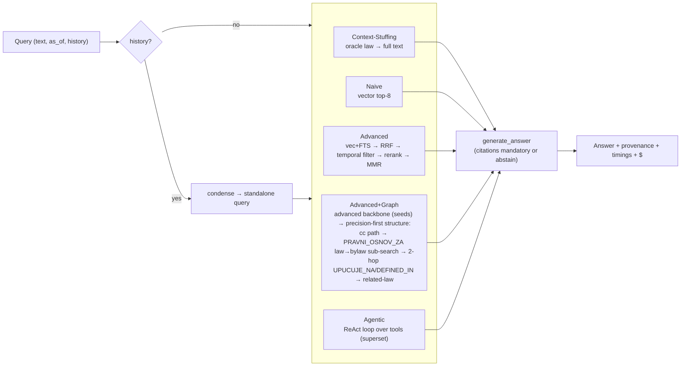

# rag_arms.md — the five retrieval arms

> One of the **six design docs** ([data_sources](./data_sources.md) · [ingestion_pipeline](./ingestion_pipeline.md) · [knowledge_base](./knowledge_base.md) · rag_arms · [ui](./ui.md) · [benchmark](./benchmark.md)). Self-contained: the **design and architecture of each arm, the shared contract, the decisions and their consequences**. Every arm retrieves over the **same** knowledge base ([knowledge_base](./knowledge_base.md)); only the retrieval strategy differs — that is what makes the comparison ([benchmark](./benchmark.md)) valid.

## 1. The attribution ladder

The arms are designed as a **monotonic capability ladder**: each adds exactly one class of capability, so any metric delta is attributable to that capability.

| Arm | Adds (over the rung above) | One-line role |
|---|---|---|
| **Context-Stuffing** | whole-law-in-context, no retrieval | the no-retrieval oracle ceiling (reported, **excluded** from the ranking) |
| **Naive** | flat top-k vector retrieval | the floor baseline; deliberately dumb |
| **Advanced** | hybrid + RRF + rerank + temporal filter + **diversity/MMR** | smart *single-stage* retrieval |
| **Advanced + Graph** | the advanced backbone **+** structural / **hierarchical law→bylaw** traversal | does structure earn its keep *on top of advanced*? |
| **Agentic** | reasoning loop over a **superset** of tools | the ceiling with planning |

**The ladder is a superset chain** — `naive → advanced → advanced+graph → agentic`. The `advanced → advanced+graph` rung is a strict output superset (pinned by the equivalence test, §6); `naive → advanced` adds stages over the same dense leg (capability superset, not output-pinned — the rerank/cap can reorder past naive's top-8); the agentic rung is a superset of the ladder's **retrieval access** (its tools reach everything the other arms reach) but deliberately not of every *stage* — its searches are un-reranked and its hops shallower (§3), so the `graph → agentic` delta reads "planning + tool use", not a single stage. The deployable id of the fourth arm stays `graph` (machine-stable across API/DB/runs), but it **is** advanced's full pipeline plus structure: its seeds come from the **same** `base._smart_retrieve` backbone advanced uses (§3), then structural expansion is added on top. With every structure toggle off it reproduces advanced exactly (a built-in equivalence check, §6). This is the standard fair-comparison protocol — hold the retriever + reranker constant and report each method's gain over the common backbone; the rejected alternative of branching `graph` off the *naive* seed would confound "−rerank/−hybrid" with "+structure" ([benchmark §9](./benchmark.md)).

**Controlled-variable rule:** the corpus is identical across arms; the generator, chunking, and prompts are held constant. Only retrieval is the treatment.

**The generation stack (held constant across every arm).** The generator is **`gemini-3.6-flash`** via the official **`google-genai`** SDK, with **native structured outputs** (`response_json_schema` + JSON MIME) so every arm returns a schema-conforming answer object rather than parsed prose; the embedder (`gemini-embedding-2`) rides the same client, one `Content` per text — a bare string list silently collapses to a single embedding. The SDK is used for Gemini specifically because its structured-output and embedding surfaces are the parts most likely to drift under a hand-rolled transport; the cross-family eval judge deliberately does **not** use an SDK (see [benchmark.md](./benchmark.md) §4). **Retry policy stays ours, not the SDK's** — one uniform layer across providers: HTTP statuses and transport blips inside the provider, parse/shape failures and cap escalation in `kl_core.llm.generate_json`. Two consequences worth knowing when reading run telemetry: the SDK brings upstream `httpx` back as *its* transitive transport (import-name distinct from the `httpx2` the rest of the codebase uses, so they coexist), and a thinking generator spends part of its output budget on thoughts — which is why the answer call runs at a 32 768-token cap rather than a nominal one. Hierarchy/structure lives **only** in the graph arm (and agentic) — keeping it out of advanced, while keeping advanced's backbone *inside* graph, is what makes the `advanced → advanced+graph` delta a clean attribution of structure.

## 2. The shared contract (`src/lexsr/arms/base.py`)

All arms subclass `RetrievalArm`:
- `retrieve(question, as_of, timer) -> (list[RetrievedChunk], extras)` — arm-specific.
- `answer(question, as_of=None, history=None, **hints) -> ArmResult` — shared: optional multi-turn condensation → `retrieve` → `generate_answer`.
- **Timer**: `timer.stage(name)` accumulates per-stage latency (ms) for every stage (embed_query, vector, fts, rerank, graph, agent, condense, llm, total).
- **`generate_answer`** (shared): a JSON-schema-constrained call returning `{answer, citations[], abstained, abstain_reason}`. `SYSTEM_PROMPT` (Serbian) mandates a citation for **every** claim; missing citations → **auto-abstain** (invariant 1). Output budget 32768 tokens (thinking-model headroom), via `kl_core.llm.generate_json` — ≤3 attempts, one 2× cap escalation on truncation.
- **`condense_query`** (shared): when `history` is present, a cheap LLM call rewrites the follow-up into a standalone retrieval query (4096-token budget); retrieval runs on the condensed query, generation gets the original + last 6 turns. Recorded in `extras.condensed_query`. Single-turn requests skip it (no cost/latency regression).
- **`ArmResult`**: `answer`, `timings_ms`, `prompt_tokens`, `output_tokens`, `cost_usd` (summed across retrieval + generation + condensation), `extras` (arm-specific). Cost/latency instrumentation is **mandatory**, not optional.

**kl_core seam types** (domain-free): `Query(text, as_of, filters)`, `Chunk(chunk_id, text, provenance, metadata)`, `Provenance(source_id, source_title, fragment, version, valid_from, valid_to, url, parent_source_id, parent_title)`, `Answer(text, citations, abstained, metadata)`. The arm-side `RetrievedChunk` (stage + score + display metadata, incl. Serbian validity fields) is a **lexsr** type (`arms/base.py`), not a kl_core seam.

## 3. The arms

### Context-Stuffing — `arms/stuffing.py` (the gold-law *ceiling*, not a ranked arm)
The no-retrieval **oracle**. **Benchmark (oracle) path:** ALL gold-cited acts (`oracle_law_slugs` — an explicit `filters.law_slug` leads; then every resolvable non-izreka act in gold order; CC-decision acts cited only via their izreka last), each act's **current-consolidation** članci fetched whole in article order (dated `@version` slices excluded — the module contract; an amended law would otherwise stuff ~3× the tokens with contradictory historical texts) and stuffed act-after-act. **Interactive path:** vector top-1 → that hit's law → stuff (truncated to `MAX_INTERACTIVE_STUFF_CHARS=120_000` ≈ 30k tokens). `SCAN_LIMIT=5000`. **Deliberately temporal-naïve** (no `as_of`, no validity annotation) — temporal failure is the designed result, and prompt size makes latency/$ the visible cost.

**Why it is a *ceiling*, reported but excluded from the deployable ranking.** Because law selection is oracle (the answer law is given a priori), this is not a deployable system — it is the **retrieval-vs-reasoning upper bound**. That is the standard, defensible use of gold/oracle context: HotpotQA's gold-supporting-fact setting is literally described as "an upper bound on performance" (Yang et al., EMNLP 2018), and KILT (Petroni et al., NAACL 2021) scores reader and retriever separately against shared gold provenance. The no-retrieval long-context condition itself is a standard RAG baseline (Xu et al., ICLR 2024; Li et al., EMNLP 2024). So it is **labelled a ceiling and kept out of the head-to-head ranking** (`evals.CEILING_ARMS`); the comparability risk the literature actually flags is *parametric leakage*, which the Serbian-statute corpus + temporal-correctness metric mitigate. Answers "the law fits the window, why retrieve?" with numbers — the ceiling is high (0.93) precisely *because* every needed act is handed to it; the +0.52 delta over its replaced single-act form is the measured value of act selection, i.e. of retrieval itself ([benchmark §9](./benchmark.md)).

### Naive — `arms/naive.py`
Embed query → vector top-`TOP_K=8`, score `1 − distance` (`_distance` is squared L2 over unit-norm vectors — monotone with cosine). No fusion, no temporal filter, no rerank, no validity annotation. **Version slices are excluded at search time** (always — naive has no `as_of` path that could want them): the dated `@version` slice rows are benchmark infrastructure a real naive deployment would never index, and letting a heavily-amended article's slices flood the top-k would lower the baseline's floor by an artifact, flattering every engineered arm's delta. **Kept deliberately flat** as the **primary deployable baseline** — the standard role of straightforward retrieve-then-generate RAG (Lewis et al., NeurIPS 2020; the "straightforward RAG" reference point in CRAG, Yang et al., NeurIPS 2024), the floor every engineered arm must beat. With the uncapped corpus it becomes the arm that *demonstrates the cost of dumping everything flat*: recall on bylaw-detail questions rises (it can now find the pravilnik) while precision drops (crowding). That precision/recall shift is a result — **not a defect to "fix"**.

### Advanced — `arms/advanced.py` (the shared smart backbone)
Smart **single-stage** retrieval. The pipeline lives in `base._smart_retrieve` (`advanced.py` is a thin wrapper) **because the graph arm reuses it as its seeds** — so advanced *is* the backbone every structural arm builds on. The stages:
1. **Dual leg:** vector top-`CANDIDATES_PER_LEG=24` (dense, DPR-style — Karpukhin et al., EMNLP 2020) + FTS top-24 (BM25 lexical — Robertson & Zaragoza, 2009; Cyrillic-transliterated query so the lexical leg matches; FTS failures fall back to vector). Sparse+dense hybrid is the standard answer to rare-token legal terminology. **With no `as_of`, both legs exclude version slices at the search level** — post-hoc routing is insufficient because a heavily-amended article's near-identical slices can fill the whole candidate window and evict the current rows entirely; with an `as_of`, slices participate and `in_force_on` selects the right one. Per-leg contribution counts ride `extras.leg_counts` (the legs fail silently by design, so the counter is the observability).
2. **RRF fusion:** `1/(RRF_K=60 + rank + 1)` summed across legs — Reciprocal Rank Fusion (Cormack, Clarke & Büttcher, SIGIR 2009).
3. **Temporal filter (if `as_of`):** `in_force_on(row, as_of)` keeps in-force candidates; **fallback** keeps top RRF if the filter empties the pool (annotate validity so the model can say "није било на снази"); tracks `dropped_by_temporal_filter`, `temporal_filter_starved`.
4. **Listwise LLM rerank:** top `RERANK_POOL=16` → ranked → top `TOP_K=8` (zero-shot listwise LLM reranking — Sun et al., *Is ChatGPT Good at Search?*, EMNLP 2023). Known to be order-sensitive (Tang et al., NAACL 2024), so it is *not* trusted to manufacture recall — it only re-orders an already-recalled pool.
5. **Diversity — bylaw-aware per-act cap, applied *after* the rerank.** At most `PER_ACT_CAP=3` chunks per **secondary** act, so the uncapped bylaw layer can't crowd top-k with near-duplicate implementing text — the anti-redundancy half of MMR (Carbonell & Goldstein, SIGIR 1998). **Primary legislation (`zakon`/`ustav`) is exempt**: one statute legitimately supplies several articles to a single answer (a rule + its exception + a definition), so capping it would *starve recall* on multi-article lookups — capping the governing act is a relevance error, not diversity. The cap runs on the **reranked order** (not the fused pool), so it shapes the final answer context without ever depriving the reranker — or generation — of the governing article. Shared primitive (`base.cap_per_act`, `kind_of`-aware), reused by graph (statute seeds protected the same way) + agentic. **No hierarchy here** (the graph arm's job).

### Graph (Advanced + Graph) — `arms/graph.py`
**Advanced's backbone + structural/hierarchical expansion on top.** The arm is a strict superset of advanced: its seeds *are* advanced's output, then structure is added.
1. **Seeds = the advanced backbone.** `base._smart_retrieve` (hybrid + RRF + temporal in-force filter + listwise rerank + diversity cap), top-`SEED_K=8` (= advanced's `SMART_TOP_K`, so the seed set is identical to advanced's result). Reusing the backbone (rather than seeding from a bare vector top-k, the rejected alternative) matters twice: the seeds inherit the `as_of` in-force filter — so the graph arm cannot cite an out-of-force unit as authority off its seed pool — and structure stays purely additive: with every structure toggle off the arm reproduces advanced exactly (§6).
2. **Bounded 2-hop BFS** over `UPUCUJE_NA` (keeps `mention`) + **term-aware** `DEFINED_IN`, fired from the reranked seeds; `MAX_HOPS=2`, `EXPAND_LIMIT=8`/query, score decays `0.9^(hop+1)`. **Never expands into repealed nodes** (a repealed neighbour is noise; still reachable as a *seed* if the question is about the repeal). The structural layer is **additive and protected**: `STRUCT_BUDGET=6` units are appended on top of the 8 seeds (final `TOP_K=14`), and — following HippoRAG/MS-GraphRAG, where structure *earns inclusion* rather than being re-judged by lexical relevance — the structural units are **not** subjected to a second relevance rerank (which would push back down the very units the graph surfaced *because* they rank low lexically). The seed rerank + the per-act diversity cap carry precision (KG-sourced rows carry the act's `vrsta`, so the cap's primary-legislation exemption applies to expanded statute articles exactly as to seeds). **Execution order within the shared budget is precision-first: cc path → bylaw hop → 2-hop expansion → related-law hop**, each with a room guard — the precise, gated hops (few, high-value rows) claim budget before the generic 2-hop fill, so truncation can never silently drop a CC holding or a delegated bylaw (an expansion-first order would allow exactly that on well-connected seed laws: the cc_path toggle on yet contributing nothing).
3. **Hierarchical law→bylaw hop, delegation-gated:** traverse `PRAVNI_OSNOV_ZA` from a hit article's `Akt` to its bylaw `Akt`, then a **scoped *hybrid* sub-search *within* that bylaw** (`_scoped_hybrid` — dense + BM25, RRF-fused, the same retrieval method as the backbone, just filtered to the act the edge selected). Using the backbone's method means the structural hop is **not handicapped relative to the seeds**, so a hop gain is attributable to the *scoping* (the graph edge narrowing ~25k chunks to one bylaw), not to a weaker reader. The hop fires **only from seed articles flagged `delegates_to_bylaw`** ("ближе прописује министар") — precise where a bylaw answer actually exists, skipped (latency + crowding saved) otherwise. `BYLAW_SUB_K ≥ PER_ACT_CAP` so the per-act diversity cap chooses from a real hybrid-ranked pool. **Known recall ceiling (§7):** the fan-out is `LIMIT BYLAW_PER_LAW` in deterministic edge-insertion order — i.e. **not relevance-ranked** — so when a law delegates to many bylaws (up to **62** materialized on the delegated-norm tier — privredna-drustva, 80 incl. stubs; corpus-wide materialized max **79** — zakon-o-radu, itself a dev-set gold act; 149 edges total for PIO) the specific gold bylaw is often not among those searched — a structural limit no reader change fixes.
4. **Hub handling:** the hub acts (`ustav-rs`/`zup`/`zoo`/`prekrsaji`, `Role.HUB` in `registry.py`) are excluded from the **act-level** reference fan-out at ingest — no hub-origin `POVEZAN_SA`/`USTAVNI_OSNOV` rows exist (0 in the store). Their **in-text `UPUCUJE_NA`** edges (~165, parsed from hub article bodies) do enter the graph and are traversed by the 2-hop layer. The related-law hop's `down_weight = 0` filter is a **residual** guard — every `POVEZAN_SA` row is 0 today, since hub acts never fan out at act level (knowledge_base §7) — keeping the graph tested on genuine topical links, not "everything cites the Constitution/ZOO".
5. **Constitutional-validity path:** from a seed law, traverse `OCENA_USTAVNOSTI` to surface the Constitutional-Court decision's materialized *izreka* (the struck article is already flagged `repealed` by CC-invalidation). Directly serves the hardest capability (`cc_validity`) and invariant 2. No `as_of` filter — a holding *reports* a strike, it isn't a provision in force.
6. **Related-law hop (experiment, `related_law_hop` toggle):** cross-law `UPUCUJE_NA` is intrinsically sparse (~264 edges); `POVEZAN_SA` (~2,453) is the densest law↔law relation. Traverse it **guarded** (non-down-weighted, materialized, other primary legislation) + a scoped sub-search, to test whether structure earns its keep on the multi-law tier. Behind a toggle so the cross-law delta is attributable — with one known confound: the hop runs **last** in the precision-first order (deliberately, as the lowest-precision experiment), so on well-connected seed laws the 2-hop fill can exhaust `STRUCT_BUDGET` before it fires, and the on/off delta is then budget-confounded (§7).

**Term-aware `DEFINED_IN` (KG construction):** `kg.structural_edges` does not link *every* article to its law's glossary (a signal-free law-global edge that inflates reach with no retrieval value). An article links to the definitions article **only when its text uses a defined term** (stem-matched for Serbian inflection); it falls back to the law-global link only when no term could be parsed (a parser-miss safety net). This is the honest construction — `arm_reachable_pct` reflects only articles with a genuine definitional dependency (~29%), not "has a glossary in its law".

`extras`: `expansion_edges[]`, `expanded_count`, `two_hop_count`, `bylaw_count`, `cc_count`, `related_count`, `bylaw_hop_gated_laws`.

### Agentic — `arms/agentic.py`
A bounded single-agent **ReAct loop** (Yao et al., ICLR 2023; single-agent per the agentic-RAG taxonomy, Singh et al. 2025 — multi-agent adds seed-to-seed variance, which a single-seed comparison could not separate from an architecture effect). `MAX_STEPS=10`, one JSON-schema-constrained action per step (`{thought, tool, args}`), then a forced answer-or-abstain over the gathered pool. **Pool-retention rule** (`POOL_CAP=24`, class-based; rationale: an unbounded `get_bylaws` fetch equal to the cap would evict every search chunk, and unbounded protected fetches could mirror-flood past the cap — both failure modes measured in a per-item, all-arm failure analysis): **seed chunks are always kept** (they are the flat-search superset guarantee); **deliberate fetches (get_clan/expand/cc) rank above refined searches**, both bounded newest-first; **bylaw sub-search bulk** fills the remaining room with a guaranteed `BYLAW_QUOTA=6` slots when bylaw chunks exist — delegated-norm answers need the statute AND the pravilnik in the pool together. The filter is order-preserving (citations are pool indices). `get_bylaws` fan-out is `BYLAW_ACTS=4` (= the graph arm's `BYLAW_PER_LAW`) acts × `BYLAW_SUB_K=3` = 12 ≤ half the pool. The `search_corpus` tool reuses the **kind-aware** diversity cap (primary legislation exempt), so the agent's own searches never starve recall on multi-article lookups.

**Tools — a superset of the ladder's retrieval *access*, deliberately not of every stage.** Every corpus region the other arms reach is reachable through a tool, but four stages are intentionally omitted so the treatment stays "planning", not "more pipeline": no listwise rerank on `search_corpus` (un-reranked by design), `expand_references` is 1-hop (vs graph's 2), no `DEFINED_IN`/`POVEZAN_SA` traversal, and the `get_bylaws` sub-search is vector-only (vs graph's `_scoped_hybrid`):
| Tool | Wraps |
|---|---|
| `search_corpus(query)` | the advanced hybrid+RRF leg (internal `SEARCH_K=6`), incl. the diversity cap |
| `get_clan(law_slug, broj)` | deterministic article fetch (follows explicit "члан 52" refs); Latin article suffixes are normalized to the corpus's Cyrillic ids (`14a` → `clan-14а`) |
| `expand_references(chunk_id)` | KG 1-hop `UPUCUJE_NA` |
| `get_bylaws(law_slug, query)` | the `PRAVNI_OSNOV_ZA` law→bylaw hop as a callable (the `query` drives the scoped sub-search within each bylaw); `query` is required — a malformed call without it falls back to the raw question and says so in the observation (falling back to the law slug instead would run a degenerate sub-search returning generic head articles) |
| `check_constitutionality(law_slug)` | `OCENA_USTAVNOSTI` → the CC decision's *izreka* (was a provision struck?) |
| `law_timeline(law_slug)` | gazette chain + validity intervals (the temporal tool) |
| `list_laws()` | corpus-scope check → calibrated abstention (scoped to seed+backbone roles) |

All slug-taking tools accept **both** the corpus slug (`zakon-o-radu`) and the ELI source_id the
policy reads off chunk_ids (`sgrs/skupstina/zakon/2005/24/1`) — the id form the policy actually
emits in practice. Observation snippets are `OBS_SNIPPET=320` chars per chunk; for CC *holding*
chunks the snippet starts at the operative part ("Утврђује се…"), skipping the court-composition
preamble, keyed on the chunk id (holdings also arrive via plain search).

**Reasoning prompt:** encodes the *general* legal-reasoning chain — "find the governing article → if it delegates ('ближе прописује министар') call `get_bylaws` and sub-search → check validity with `law_timeline` → confirm scope with `list_laws` before abstaining" — plus a **finish gate**: before `finish`, name the specific provision answering *each* sub-question and fetch any you cannot name (counters a sufficiency bias on two-part questions — finishing once each half has *an* answer rather than the enumerated provisions). These are **general heuristics, never gold-leaking question-specific hints** (else the agentic win is contaminated). `MAX_STEPS`/`POOL_CAP` are sized for the uncapped corpus + the extra hop; the retention rule above bounds every fetch class, so no single tool's output can flood out another's. Every tool call → `extras.tool_trace` (step, tool, thought, args, chunks_added) → the UI drill-down + honest $/query.

**Seed search (`seed_search` ablation toggle, default on):** before the loop, the pool is seeded
with one `search_corpus` call on the **raw question** (trace entry `seed: true`, step 0, fed to the
policy as "Корак 0"). Rationale: the loop's own reformulated queries measurably miss golds the raw
question finds via the flat hybrid leg — with the seed, the agent *refines*
retrieval instead of re-deriving it, making the agentic arm a retrieval superset of the flat
search leg (the superset principle extended to the ladder's top). Seed chunks carry their own
stage (`agent-seed`) so the pool-retention rule can honor that guarantee unconditionally. A
repeat-call guard also annotates identical (tool, args) invocations in the observation so the
policy stops burning step budget on duplicates.

**Harness-integrity rules (not ablation toggles — the loop's contract; each guards a generator failure mode measured in the generator-shift analysis, [benchmark §9](./benchmark.md)):**
- **Decision resilience:** each decision runs through `kl_core.llm.generate_json` (≤3 attempts); failed attempts land in the trace as `__decision_retry__` entries (error, finish_reason, raw preview) — a parse failure is never a silent loop exit. On give-up the loop concludes; attempt/give-up counters ride `extras.llm_io.decision`.
- **No conclusion without research** — the abstention mirror of invariant 1 ("no claim without provenance"): if the loop concludes (finish, decision give-up, or step exhaustion) with an **empty pool and no search that actually ran**, the harness executes one seeded `search_corpus(question)` before the answer stage, logged `forced: true` in the trace + `extras.forced_search`. A search that ran and legitimately found nothing disarms it — "searched, found nothing" is a meaningful abstention; "never looked" is not.
- **Generation failures ≠ abstentions:** an answer generation still unparseable after retries is flagged `extras.generation_failed` — the eval runner routes it to the batch errors list and the run stores exclude it from abstention metrics.

## 4. Multi-turn, temporal, provenance (cross-cutting)

- **Multi-turn:** condensation + last-6-turn transcript, shared by all arms except context-stuffing; `conversation_id` groups turns in telemetry.
- **Temporal:** advanced/graph/agentic respect `as_of` (filter to in-force). Context blocks annotate validity in Serbian ("на снази од…", "престао да важи…", "у примени од…").
- **Provenance of the delegation chain (decided):** when an answer comes from a bylaw, the citation renders the bylaw **with its parent law** ("Pravilnik X, donet na osnovu Zakona Y"). Produced for **every** arm at render time from the `PRAVNI_OSNOV_ZA` edges (`base._provenance`), not only by the arms that traversed the edge. The shared render path is pinned by unit tests; the edge-derivation itself (`base._parent_map` — first parent wins) is not yet covered by a fixture test.

## 5. Orchestration framework — LangGraph / LlamaIndex? (assessed, rejected)

**Decision: hand-rolled, no orchestration framework.** The assessment holds for a single bounded agent; it would not hold for a multi-agent loop.

- The agentic loop is a single agent, ≤10 steps, 7 typed tools, one JSON-schema action per step. That is explicit Python with full control over the pool-eviction rule, per-tool stage timing, and the tool trace. A framework buys nothing here and costs: an extra dependency (against the "dependencies stay boring" rule), version churn, and **opacity in exactly the place the benchmark needs transparency** ($/query, latency-per-tool, the trace).
- LangGraph's value is multi-node graphs with branching/checkpointing/human-in-the-loop. We deliberately chose **single-agent** (multi-agent would add seed-to-seed variance this evaluation cannot separate out — §3). So the value proposition doesn't apply.
- LlamaIndex/Haystack would abstract retrieval, but our retrieval *is the experiment* — we need the raw RRF/rerank/graph-hop internals exposed and instrumented, not hidden behind a black-box `QueryEngine`.
- **The condition that would change the answer:** genuine multi-agent orchestration, or checkpointed long-running workflows. Neither exists here, and for a single bounded loop a function does the job.

## 6. The ablation surface (the study knobs)

Each engineered capability above is a **binary ablation toggle** (`AblationConfig`, `arms/base.py`), so a metric delta between a run and its ablated twin is attributable to *that one capability* — the attribution ladder (§1) made testable per-stage rather than only per-arm. Every toggle **defaults to the production setting**, so the default config reproduces each arm's full pipeline unchanged; the floor (naive) and the oracle ceiling (context-stuffing) are deliberately knob-free (ablating them would change what they *are*). This is the standard component-ablation methodology for attributing a system's gains (e.g. the per-module ablations in Self-RAG, Asai et al., ICLR 2024; the retrieve/rerank/filter ablations in RAG surveys).

| Toggle | Arms | Isolates |
|---|---|---|
| `temporal_filter` | advanced · graph · agentic | the `as_of` in-force filter (invariant 2 / temporal-correctness metric) |
| `diversity_cap` | advanced · graph · agentic | the per-act MMR cap (the crowding result) |
| `hybrid` | advanced · graph (shared backbone + scoped sub-search) | dense+BM25 vs dense-only (the value of the lexical leg) |
| `rerank` | advanced · graph (shared backbone) | the listwise LLM rerank (also a $/latency ablation) |
| `graph_expand` | graph | the 2-hop `UPUCUJE_NA`/`DEFINED_IN` expansion |
| `bylaw_hop` | graph | the law→bylaw `PRAVNI_OSNOV_ZA` hop |
| `delegation_gate` | graph | gate-on-`delegates_to_bylaw` vs fire-from-all-seeds (the precision/recall question below) |
| `cc_path` | graph | the constitutional-validity `OCENA_USTAVNOSTI` path |
| `related_law_hop` | graph | the guarded `POVEZAN_SA` cross-law experiment |
| `seed_search` | agentic | the raw-question pool seed before the ReAct loop (the superset principle at the ladder's top) |

The exact config rides **every run's telemetry** (`extras.ablation` full dict + the `ablation` column's compact label, e.g. `no-rerank,no-temporal_filter`) so a stored result is self-describing and a batch is grouped by the config it ran under. Surfaced in the UI (Chat per-question, Benchmark per-run) and runnable headless (`lexsr.evals --ablate rerank,temporal_filter`). Agentic exposes the two cross-cutting toggles plus `seed_search` — its tool *superset* is the planning-ceiling treatment, not ablated per-tool.

**The superset/equivalence property.** Because the graph arm's seeds are advanced's `_smart_retrieve` output, turning **all four structure toggles off** (`graph_expand`, `bylaw_hop`, `cc_path`, `related_law_hop`) reduces the graph arm to advanced exactly — same seeds, same chunks. This is pinned by a unit test (`test_graph_structure_off_reproduces_advanced`) and is the built-in check that `advanced+graph ⊇ advanced`: any `advanced → advanced+graph` delta is then attributable purely to the structure toggles, not to a backbone difference.

**Operational rule: one config per batch.** `batch_stats` aggregates over the rows in a batch, so mixing ablation configs *within* one batch averages across treatments (the `ablation` column then shows the last-seen label). Run each ablation as its **own** batch — the UI does this; on the CLI, one `--ablate …` per run. (A per-request ablation in the API rebuilds the arm uncached — `_arm_with` LRU-caches only the production config — which is correct but not free; it is a per-request cost, not a batch concern.)

## 7. Open questions & consequences

- **The bylaw-recall bottleneck is the *non-relevance-ranked fan-out*, not the gate or the reader.** A retrieval-only diagnostic on the delegated-norm tier isolates the cause among three candidates: (1) the **delegation gate** is not the bottleneck — loosening it (`--ablate delegation_gate`) fires the hop on more laws but leaves gold-bylaw-in-pool unchanged (2/8 gated = 2/8 ungated); (2) the **within-bylaw reader** is not the bottleneck — with the scoped sub-search equalized to the backbone's hybrid (`_scoped_hybrid`), recall stays at 2/8; (3) the **law→bylaw fan-out** is — `_BYLAW_QUERY` truncates at `LIMIT BYLAW_PER_LAW` in deterministic edge-insertion order, **not relevance order**, and Serbian laws delegate to *many* bylaws (up to **62** materialized on the delegated-norm tier, **79** corpus-wide), so the specific gold bylaw is usually not among the handful searched. That is the recall ceiling. **Consequence + the reason it's left open:** fixing it means **relevance-ranking the fan-out** (embed bylaw titles / rank by the query) — but ranking which bylaw to search by query relevance *is itself retrieval*, the thing advanced already does corpus-wide. So the hop, to reach the gold bylaw advanced misses, would have to re-derive advanced's retrieval — which is exactly why on this corpus typed structure adds no retrieval power flat retrieval doesn't already have ([benchmark §9](./benchmark.md)). The hybrid reader is kept (it removes a genuine handicap, so the negative result is fair on the reader axis) but the fan-out is left unranked — deliberately, on two grounds: tuning the arm until it wins would forfeit the negative result, and this set could not adjudicate the change anyway, since its delegated-norm items have been error-analyzed one by one and anything tuned against them would be contaminated. The shape of a defensible test is known — relevance-rank the `PRAVNI_OSNOV_ZA`-derived bylaws by the query, search the top-N, run it on held-out data, and attribute the delta with the `bylaw_hop` ablation, which would ask whether the legal-derivation *filter* beats unrestricted hybrid — but no such measurement exists, so whether the hop can be made to pay is an **open, unanswered question**, not a pending item.
- **Consequence — temporal safety comes from the shared backbone.** Because the graph seeds run through `_smart_retrieve`'s in-force filter, the seed pool can't carry an out-of-force unit cited as authority (`temporally_wrong_and_cited = 0`); the cc-validity `izreka` stays deliberately exempt (a holding *reports* a strike, it isn't a provision in force). This is why structure is kept purely additive *on top of* the filtered backbone rather than seeding independently.
- **The related-law hop is an experiment.** Cross-law `UPUCUJE_NA` is intrinsically sparse, so the hop leans on the denser `POVEZAN_SA` relation; whether that converts to accuracy on the multi-law tier — or stays a labelled negative — is measured by running the re-bench with the `related_law_hop` toggle on and off (§6). One caveat rides the measurement: the hop runs last in the precision-first order, so the on/off delta is **budget-confounded** whenever the 2-hop fill exhausts `STRUCT_BUDGET` first (§3) — interpret a null delta with that in mind.
- **Citation provenance for bylaws is half-complete.** The bylaw → parent-law link renders for every arm ("· на основу: Закон Y", from the `PRAVNI_OSNOV_ZA` edges at render time, no re-embed). The delegating *article* ("čl. Z") is **not** captured in the edge data — surfacing it would need extraction at edge-build time and a re-ingest.
- **The graph arm's value is definition-/validity-aware traversal, not citation multi-hop** — a consequence of corpus sparsity, not a deficiency of the arm ([benchmark](./benchmark.md) §6). The hub-exclusion and term-aware `DEFINED_IN` choices keep what traversal there is honest rather than inflated.
- **The agentic `search_corpus` tool carries its own copy of the hybrid backbone** (`agentic._search_corpus`, with its own `CANDIDATES_PER_LEG=16`/`SEARCH_K=6`) rather than calling `base._hybrid_candidates`. It is correct and intentionally un-reranked (the agent's planning is the treatment, not a per-call rerank), but it is a dedup opportunity — fold it onto the shared primitive (with a `per_leg` parameter to preserve its smaller pool). One semantic the fold must decide: the copy does **not** honor the `hybrid` ablation toggle (no `config.hybrid` guard, unlike the backbone and `_scoped_hybrid`), so folding would change agentic's ablation semantics — decide deliberately, not as a side effect. Queued for the next non-release-critical agentic touch.
- **Orchestration stays hand-rolled** (§5) unless the agentic arm grows genuinely multi-agent or long-running/checkpointed — at which point LangGraph is worth re-evaluating.
- **Consequence — the oracle is all-gold-acts (the faithful ceiling).** The arm stuffs every resolvable gold-cited act (matching its HotpotQA/KILT gold-supporting-fact lineage), executed as a disclosed same-day post-campaign correction of the original single-act form: single-act scored 0.42 with all 35 misses multi-act; all-acts scores 0.93 at 13.2× naive's cost. The +0.52 delta is the measured value of perfect act *selection* — the retrieval problem itself — and the arm's cost identity changed accordingly (whole-acts-in-context, now plural).
