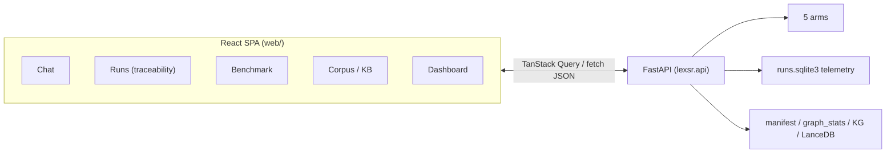

# ui.md — the web application

> One of the **six design docs** ([data_sources](./data_sources.md) · [ingestion_pipeline](./ingestion_pipeline.md) · [knowledge_base](./knowledge_base.md) · [rag_arms](./rag_arms.md) · ui · [benchmark](./benchmark.md)). Self-contained: the **UI organization, the five surfaces, the data flow, and the design justifications**. The UI is a thin client over the FastAPI backend; it consumes the same telemetry rows the eval harness reads ([benchmark](./benchmark.md)).

## 1. Purpose & stack

The UI serves two audiences at once: a **citizen/practitioner** trying the assistant, and a **researcher** inspecting how each arm retrieves, what it cited, and what it cost. Every surface therefore foregrounds **provenance, temporality, and cost** — the project's invariants made visible. Surfacing the cited source next to every claim so a reader can check it is precisely the *verifiability* property that attributed-generation research measures (Liu et al., *Evaluating Verifiability in Generative Search Engines*, Findings of EMNLP 2023; Gao et al., ALCE, EMNLP 2023) — and which existing generative search engines were found to fail more than half the time. In a high-stakes domain, exposing the model's evidence is the baseline form of explainability the human-AI literature calls for over post-hoc rationales (Rudin, *Nature Machine Intelligence* 2019).

**Stack (`web/`, deliberately boring — no UI kit):** React 19 + TypeScript + Vite + TailwindCSS 4 + **TanStack Query** (fetch/cache/poll) + **Recharts** (charts). Components are hand-rolled. Dev: `npm run dev` (Vite :5173, proxies `/api` → uvicorn :8000). **Prod/deploy: `cd web && npm run build`, then uvicorn alone serves everything** — `lexsr.api` mounts `web/dist` at `/` when it exists (same-origin `/api`, no proxy, one process). Typed client in `web/src/api.ts` mirrors the Pydantic models 1:1; arm labels in `web/src/arms.ts`. **E2E (Playwright, `web/e2e/`):** `api.spec.ts` exercises the FastAPI backend, `app.spec.ts` the browser UI across all five tabs; `playwright.config.ts` boots uvicorn :8000 + vite :5173 (reusing running servers; `E2E_API_PORT` relocates the backend).

## 2. The five surfaces

### 1) Chat — the assistant experience (`Chat.tsx`)
A chatbot with the research controls a benchmark needs.
- **Arm selector** (dropdown, default `advanced`) — *which arm am I testing* is front-and-center; the comparison is the whole point.
- **Ablation toggles** (`AblationControls`, rendered from `/api/ablations`) — per-question capability switches (temporal filter, diversity cap, hybrid, rerank, graph hops, agentic seed search) so a user can turn any engineered capability off and watch the effect on that single answer (the ablation surface, [rag_arms §6](./rag_arms.md)).
- **`as_of` date input** (optional) — ask "what governed this on date X".
- **Multi-turn**: the transcript *is* the memory (`asHistory(messages)` sent with each ask; `conversation_id` per chat). "Conversation · N turns" + "New chat" reset.
- **Answer rendering**: the answer, **citation badges** (source title + fragment, tooltip with `valid_from→valid_to`, version), an **abstained** badge + reason (amber) when applicable, and an expandable **Sources** panel (retrieved chunks with stage, structural_path, validity, and a "делегира → подзаконски акт" badge on delegating articles; per-chunk scores live in the Runs detail, not here).
- **Validity badges** on chunks: red "престао да важи DATE" / green "на снази од DATE [· у примени од DATE]" — the temporal invariant, visible.

### 2) Runs — the traceability surface (`Runs.tsx`)
Split-pane: run list (left) + full detail (right). The "show your work" surface.
- **List columns:** when, arm, question, graded ✓/✗/· (partial correctness is spelled out in the detail panel, not a list glyph), ms, $. **Batch filter** (default all).
- **Detail panel:** header (arm, as_of, batch, model, ts); **eval panel** if graded (correctness, citation precision/recall/F1, judge rationale); **stage-timing stacked bar** (per-stage ms, colored); **token/cost grid**; **condensed query** badge (multi-turn); an **LLM-retries banner** (amber, per-stage failed-attempt/give-up counts whenever any LLM stage retried — the resilience layer made visible); **agent trace** (agentic) — ordered tool steps with thought + args + chunks_added; the **answer**; **retrieved chunks** (cited ones highlighted, with validity + structural path + snippet).
- This is where the agentic loop and the per-arm internals become inspectable — the credibility surface for the whole comparison.

### 3) Benchmark — author, run, compare (`Benchmark.tsx`)
A **golden-set selector** scopes all three subviews (`/api/golden/sets`; the two live sets are `golden-situational-60` and `-30`), and batches are tagged with the set they ran on. Three subviews:
- **Questions:** golden items grouped by difficulty tier (easy/medium/hard), CRUD via an editor modal (question, gold answer — empty ⇒ `null`, so abstain items stay authorable — primary law slug, gold citations one-per-line); the **backend validates on save** (`bench.validate_item`: citation format "source_id::član N", citation→non-empty-corpus-chunk resolution, and gold-answer grounding overlap — errors surface in the modal). The editor sends a **partial payload and the backend merges** into the stored item, so annotations the modal doesn't surface (`capability`, `temporal_mode`, `query.as_of`, reachability labels) survive an edit.
- **Run:** select arms + tiers (+ optional limit — total questions, applied after the tier filter — + batch label) + per-run **ablation toggles** (`AblationControls`, from `/api/ablations`; one config per batch — [rag_arms §6](./rag_arms.md)), launch a background batch, watch **live progress** (status, progress bar, last step). The job id lives in the tab's parent state, so switching sub-views doesn't orphan a running batch, and Results queries invalidate when the job completes. Cost/time warning shown.
- **Results:** batch selector → a **per-arm stats table** (n, accuracy, citation precision/recall/F1, abstain, avg ms, avg $/q), a **provenance & safety table** (retrieval recall, the retrieval−citation gap, misgrounded / temporally-wrong-cited / hallucination rates, over-/under-abstention), an **accuracy / prov.F1 bar chart**, and a **per-question side-by-side** correctness comparison. (The tier × arm and capability × arm matrices live in the CLI eval report — [benchmark §5](./benchmark.md) — not the web UI.)

### 4) Corpus / Knowledge base (`Corpus.tsx`)
The "what's in the KB" overview.
- **Summary cards** (laws, članova, repealed članova) + the periphery counts (materialized bylaws, CC decisions, stubs, acts total).
- **Cluster map** — the colour ↔ number ↔ name key for the ten thematic clusters + the shared backbone, with per-cluster law counts (the legend for every cluster-coloured element).
- **Graph topology** (`/api/corpus/stats`): nodes, edges, mean out-degree, isolated %, cross-law edge count, `arm_reachable_pct` — with the sparsity note (the honest GraphRAG story made visible).
- **All-laws table** — every seed/backbone law with cluster, gazette chain (links to PIS), članova, repealed, and the three temporal dates.
- **There is no cross-reference graph visualization in the shipped UI.** It was built and cut because the rendering was poor — on a corpus whose numbered cross-reference web is intrinsically sparse ([benchmark §6](./benchmark.md)), it communicated less than the numbers do — so the cluster map + topology stats carry the structural story instead. The `/api/corpus/graph` + `/corpus/article-graph` endpoints and their typed-client stubs still exist and are unused by any tab.

### 5) Dashboard — segment metrics across runs (`Dashboard.tsx`)
Real-time telemetry (5 s refetch). **Batch selector** ("All runs" vs per-batch) — the segmentation the user asked for. Summary cards (total runs, total $, corpus size, repealed) + **per-arm cards** (runs, abstain rate, avg latency, avg $/q, tokens) + **latency chart** (p50/p95 per arm) + **cost chart** ($/q per arm).

## 3. How the UI talks to the backend (`lexsr.api`)

| Surface | Endpoints |
|---|---|
| Chat | `POST /api/ask`, `GET /api/arms`, `GET /api/ablations` |
| Runs | `GET /api/runs`, `GET /api/runs/{id}`, `GET /api/batches` |
| Benchmark | `GET /api/golden/sets`, `GET/PUT /api/golden`, `DELETE /api/golden/{item_id}`, `GET /api/arms`, `GET /api/ablations`, `POST /api/benchmark/run`, `GET /api/benchmark/jobs/{id}` (the `/jobs` list endpoint exists server-side, no UI call site), `GET /api/batches`, `GET /api/batches/{id}/stats`, `/items` |
| Corpus | `GET /api/corpus`, `/corpus/summary`, `/corpus/stats` (`/corpus/graph` + `/corpus/article-graph` exist server-side but have no UI call sites — the graph viz they fed is not shipped, §2.4) |
| Dashboard | `GET /api/stats`, `GET /api/batches`, `GET /api/corpus` (the corpus/repealed cards) |

Every `/api/ask` is persisted in full (retrieved chunks w/ scores+stages, citations, per-stage timings, tokens, cost, extras) — **the dashboards are views over the same rows the eval harness reads** (one source of truth for interactive + benchmark telemetry).

## 4. Design justifications

| Choice | Why |
|---|---|
| **Arm selection on every surface** | The product *is* the comparison; a user must always be able to pick/segment by arm. |
| **Provenance + validity badges everywhere** | The two invariants (citation, time-indexing) are only credible if they're visible on every answer and chunk. A claim is *verifiable* only when its supporting source is shown inline for the reader to check — the precision/recall property formalized for attributed generation (Liu et al., EMNLP-F 2023; Gao et al., ALCE, EMNLP 2023). |
| **Telemetry = the eval substrate** | No separate "demo mode" vs "benchmark mode" data path → the numbers shown to users are the same rows the eval reports are computed from. |
| **Hand-rolled components, no UI kit** | "Dependencies stay boring"; the views are simple (tables, badges, Recharts); a kit adds weight and lock-in for no gain. |
| **Transcript-as-memory (no server session)** | Stateless backend; conversations are reproducible from the transcript the client sends; matches the condense-question design ([rag_arms](./rag_arms.md)). |
| **Agent trace as a first-class view** | The agentic arm's cost/benefit is only defensible if its steps, tools, and pool are inspectable. |

## 5. References

All citations verified against the primary source (ACL Anthology / arXiv / publisher DOI).

- Liu, N. F., Zhang, T., & Liang, P. (2023). *Evaluating Verifiability in Generative Search Engines.* Findings of EMNLP 2023. https://aclanthology.org/2023.findings-emnlp.467/
- Gao, T., Yen, H., Yu, J., & Chen, D. (2023). *Enabling Large Language Models to Generate Text with Citations* (ALCE benchmark). Proceedings of EMNLP 2023, 6465–6488. https://aclanthology.org/2023.emnlp-main.398/
- Rudin, C. (2019). *Stop Explaining Black Box Machine Learning Models for High Stakes Decisions and Use Interpretable Models Instead.* Nature Machine Intelligence, 1, 206–215. https://www.nature.com/articles/s42256-019-0048-x

## 6. Open questions & consequences

- **No visualization of the corpus graph reads well.** The one that was built was cut for poor legibility (§2.4) and the cluster map + topology stats are what ships; whether a rendering exists that makes a sparse citation web informative is unresolved. The graph API endpoints, typed-client stubs, and the now-unused `3d-force-graph`/`three`/`three-spritetext` deps remain in the tree.
- **Bundle weight.** The built main chunk is ~654 kB, over the 500 kB vite warning threshold (no code-splitting or lazy loading configured); benign for the local/demo app, but code-splitting is the obvious lever if it matters. Part of that weight is the three graph-rendering deps nothing imports at runtime.
- **Two hard-coded literals should be derived.** The bench cost/time warning (`Benchmark.tsx`: "the full 60×5 matrix costs ≈ $15–25…") should estimate from the selected arms × items — the fixed string is wrong whenever the 30-item set is selected. And Chat's arm picker seeds with a hard-coded `["naive", "advanced", "graph"]` default while `/api/arms` loads — a slow/failed fetch silently offers three of the five arms.
- **No loading/error surface outside Chat.** A failed fetch renders as a blank panel (components return `null` or an empty table; no error boundary) — only Chat shows a ⚠ bubble. Given that "a UI bug in a metric is a benchmark bug", a backend error should be visibly an error, not an empty dashboard.
- **Consequence — telemetry is the single source of truth.** There is no separate "demo mode" data path: the numbers users see in Chat/Runs/Dashboard are the same rows the eval harness reads, so a UI bug in a metric is a benchmark bug, not just a display glitch — the metric cards coalesce missing fields defensively for that reason.
